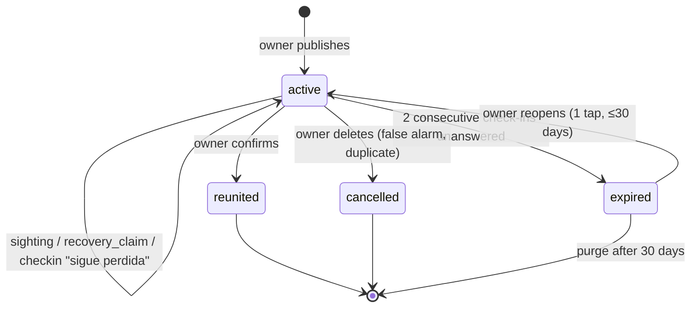

# Lost Workflow — States & Domain

> The PERDIDO vertical, defined from scratch. This document is the source of truth for the lost flow;
> where it disagrees with earlier docs, this one wins and the others get patched.
> Domain identifiers are English/snake_case; Spanish strings are UI copy.

## The flow, in one pass

```
owner ──publishes──▶ lost_case (active) ──▶ broadcast (push · feed · shareable card)
                            │
                            ├── "Lo vi"    → sighting        (many, informational)
                            ├── "Lo tengo" → recovery_claim  (few, custody)
                            │
                            └── system check-ins ──▶ owner answers ──▶ reunited
                                                     owner silent  ──▶ expired
```

## The organizing insight

The neighborhood responds in **two structurally different ways**, and collapsing them into one
"report" is the mistake to avoid:

| | **Sighting** — "Lo vi" | **Recovery claim** — "Lo tengo" |
|---|---|---|
| Semantics | Information: the pet was *here* at *this time* | Custody: someone physically has the pet |
| Volume | High (many per case) | Low (0–2 per case) |
| Trust needed | Low — a wrong pin costs little | High — drives case resolution |
| Product value | The trajectory map on the post | Opening a contact channel, fast |
| Resolves the case? | Never | Only after **owner confirmation** |
| Inputs | pin + time + contact + photo? | contact + pin? + photo? |

Sightings are volume plays; recovery claims are the resolution path. Separate tables, separate rate
limits, separate moderation treatment.


---

## Entities

### `pet`
Created by the system as a side effect of the lost report — the owner never fills a "pet profile"
form. Fields: species, breed_guess, size, colors[], marks, photos[], chip_number, name.

`custody_state: claimed | unclaimed | org_held`

**A pet is never "lost".** "Lost" is a property of an open case, not of the animal:

```
pet_is_lost := EXISTS case WHERE pet_id = ? AND type = 'lost' AND status = 'active'
```

Derived, never stored twice. This is the most important modeling rule here — storing
`pet.state = 'lost'` guarantees drift the first time a case expires without anyone touching the
pet row.

### `responsibility_link` — person/org ↔ pet
`role: owner | custodian | org`, with `active_from` / `active_to`. Transferable; history survives.

An owner publishing a lost report gets `role = owner` at creation, and **it never changes through
this flow**. Reunion transfers nothing back — nothing was taken away. Custody only moves in the
*merge* path below, where a separate unclaimed record is absorbed.

### `lost_case`
| Field | Notes |
|---|---|
| `pet_id`, `created_by` | Publisher is a registered person (account + phone verified) |
| `last_seen_point`, `last_seen_at` | Map pin + timestamp |
| `contact_prefs` | `expose_whatsapp`, `expose_email`, `in_app_only` |
| `status` | See state machine |
| `resolution`, `resolution_attribution` | Set on terminal transition |
| `published_at`, `next_checkin_at`, `resolved_at` | |

### `sighting`
`case_id`, `point`, `seen_at`, `photos[]`, `note`, `source: anonymous | registered`,
`reporter_person_id?`, `reporter_contact`,
`status: visible | hidden_by_owner | removed_by_moderation`.

Default `visible` — publishing a sighting must be instant, or the map dies. The owner can hide any
pin; moderation removes abuse. Anti-spam is **rate limiting + owner-hides-pin**, never pre-approval, we can handle this by making the users just being able to drop a point per case at the time, in case they want to put other we need to remove it, the how needs to be validate in terms of UX if the user should remove the pin by a button, just by clicking another place, others.

we should limit the map to put the sighting at least to the city or a radius of certain meters near you. nice to have.

### `recovery_claim`
`case_id`, `claimant` (person or anonymous contact), `point?`, `photos[]`,
`status: open | confirmed | dismissed | stale`.

Creating one **opens a contact channel** and **schedules accelerated check-ins**. It never changes
the case status by itself.

### `case_checkin`
`case_id`, `scheduled_at`, `trigger: time_based | post_recovery_claim`, `sent_at`, `channel`,
`responded_at`, `response: still_lost | reunited | delete`.

---

## Case state machine



Four statuses. Deliberate — every candidate fifth state turned out to be derived:

| Rejected state | Why it's derived instead |
|---|---|
| `pending_confirmation` | = `EXISTS recovery_claim WHERE status = 'open'`. A UI badge ("posible hallazgo"), not a status |
| `paused` | v2. No evidence owners want to mute a search mid-search |
| `draft` | The publish form is one screen; there is nothing to draft |
| `archived` | A retention phase applied to terminal cases, not a lifecycle state |

### Rule: a recovery claim must never reduce reach

Tempting and wrong: throttling the broadcast when someone says "lo tengo". One false or mistaken
claim would then silently kill an active search, and the failure is invisible to the owner. So:

> An open recovery claim changes **only the check-in schedule and the UI badge**.
> Push, feed ranking, and sharing continue unchanged until the owner confirms.

### Rule: only the owner closes a case as reunited

No timeout, no claimant action, no moderator ever sets `reunited`. Silence resolves to `expired`,
which is reversible; `reunited` is not.

### `resolution` values (set on terminal transition)

`reunited_home` · `found_deceased` · `gave_up` · `false_alarm` · `duplicate` · `no_response`

`resolution_attribution: platform_sighting | platform_claim | platform_share | offline | unknown`
— captured by asking «¿quién te ayudó?» at the reunion moment. This is what makes "real reunions
per week" a number you can report honestly instead of guess at.

---

## The follow-up loop

Framed **negatively**, as specified: never "did you find your pet?" (a question an exhausted owner
ignores), always "this listing goes away unless you keep it":

> «Luna sigue publicada como perdida. Si no nos confirmas, archivaremos la publicación en 5 días.»
> `[ Sigue perdida ]  [ Ya apareció 🎉 ]  [ Eliminar ]`

### Schedule

| Trigger | Cadence |
|---|---|
| Time-based (default) | T+72h, then every 7 days |
| An open `recovery_claim` exists | +24h and +72h from the claim, then back to the weekly rhythm |
| Any owner interaction with the case | Resets `next_checkin_at` |

**Escalation:** push → WhatsApp template (24h later) → email (48h later).
**Expiry:** two consecutive unanswered check-ins ≈ 14 days of silence → `expired`.

`expired` is soft: gone from feed and push, still reachable by direct link (WhatsApp shares stay
alive), reopenable in one tap for 30 days. After 30 days: purge anonymous sighter contacts, keep the
pet record.

---

## Identity ladder for this vertical

| Action | Anonymous | Registered |
|---|---|---|
| View, share the card | ✓ | ✓ |
| Report a sighting | ✓ — pin + time **+ contact (required)**, photo optional | ✓ — contact from profile, photo optional |
| "Lo tengo" | ✓ — WhatsApp | ✓ — WhatsApp **or** in-app thread |
| Contact the owner | ✓ — WhatsApp deep link | ✓ — WhatsApp or in-app thread |
| Earn points / attribution | ✗ | ✓ |
| Publish a lost case | ✗ | ✓ — OAuth + phone verified |

Contact is **required** for anonymous sightings: a pin nobody can follow up on is nearly worthless to
an owner, whose immediate next question is always «¿en qué esquina exactamente?». Registered users
supply it implicitly from their profile, so the field only ever appears to anonymous reporters.

---

## Interaction with FOUND cases (the merge path)

Two entry points that must not be confused:

1. **"Lo tengo" on an existing lost case** → `recovery_claim`. No new pet, no new case; the pet is
   already `claimed` and identified.
2. **Independent found publication** (a finder posts a stray, no lost case in sight) → new
   `unclaimed` pet + `found_case`, finder linked as **custodian**.

Matching bridges them: when a `found_case` and a `lost_case` are mutually confirmed as the same
animal, the unclaimed pet folds into the claimed pet, the custodian link closes, the owner link
continues, and **both** cases resolve as reunited. The merge must be reversible — a wrong merge
otherwise destroys two records at once.

---

## Events

For analytics, notifications, and points attribution:

`lost_case.published` · `lost_case.broadcast_sent` · `sighting.reported` · `sighting.hidden` ·
`recovery_claim.opened` · `recovery_claim.confirmed` · `recovery_claim.dismissed` ·
`contact.opened` (whatsapp_click | thread_created) · `checkin.sent` · `checkin.responded` ·
`lost_case.reunited` · `lost_case.expired` · `lost_case.cancelled` · `pet.merged`

---

## Open questions

| # | Question | Recommendation |
|---|---|---|
| 1 | OTP-verify the anonymous sighting phone? | **No.** OTP at the sighting moment costs more reports than it stops spam. Rate-limit by device/IP; the owner hides bad pins |
| 2 | Public precision of sighting pins and `last_seen_point` | Fuzz the public marker to ~200 m. A last-seen pin is a home address by proxy — real Ley 1581 exposure |
| 3 | Rewards attract fake "lo tengo" claims | Keep the field, display-only, plus warning copy: never pay before recovering the pet |
| 4 | Duplicate lost cases for the same pet (owner + a well-meaning neighbor) | Detect on publish by geo + species + time window; offer «¿es la misma mascota?» rather than blocking |
| 5 | Re-push when sightings cluster far from the original pin? | v2 — powerful («se movió hacia el norte»), but measure the first broadcast before adding a second |
| 6 | Can a registered helper convert their own sighting into "lo tengo"? | Yes, one tap — it's the natural escalation and preserves attribution |
