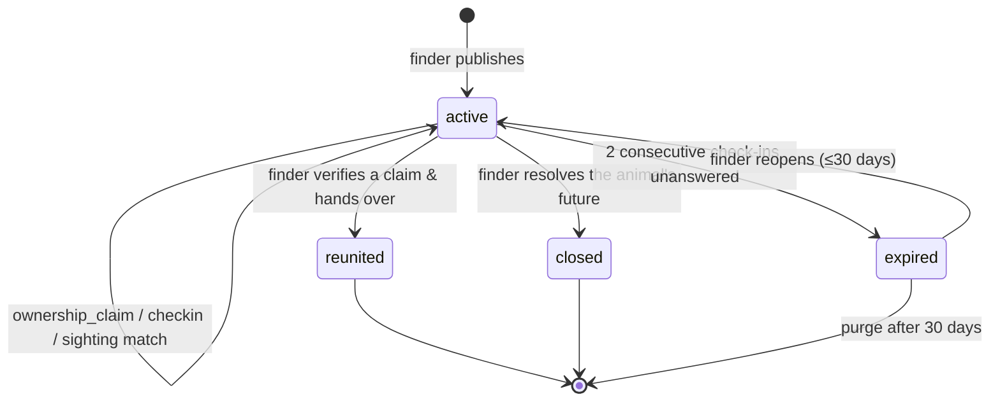

# Found Workflow — States & Domain

> The ENCONTRADO vertical. Companion to [04 · Perdido](04-lost-workflow_draft_1.md), which it reuses
> heavily — but it is **not** its mirror image. The asymmetries below are the whole design.
> Domain identifiers are English/snake_case; Spanish strings are UI copy.

## Why this isn't LOST with the arrows reversed

| | LOST | FOUND |
|---|---|---|
| Publisher | Owner — knows the pet completely | Finder — knows nothing about it |
| Pet record | `claimed`, owner link exists | `unclaimed`, **no owner may ever appear** |
| Publisher's clock | None. You can search for a year | **Days.** There is a strange dog in their apartment |
| Incoming claim | "Lo tengo" — low risk, worst case a false lead | "Es mío" — **a stranger asking to take an animal** |
| Success | One ending: the pet comes home | Several honorable endings, most without an owner |
| Real question | "Where is my pet?" | "What happens to this animal if nobody comes?" |

That last row is the design driver. A LOST case is a search. A FOUND case is **custody in limbo with a
deadline**, and the product's job is to resolve the limbo — ideally by reunion, otherwise by routing
the animal somewhere better than a stranger's balcony.

## The flow, in one pass

```
finder ──publishes──▶ found_case (active) ──▶ matching · feed · shareable card
                            │
                            ├── ownership_claim ──▶ finder verifies ──▶ reunited
                            │
                            └── hold clock runs ──▶ day ~15: «¿publicar en adopción?»
                                                    └──▶ closed (adoptable | org | kept)
```

---

## The organizing split: custody, not identity

LOST splits its responders by *what they know* (sighting vs. recovery claim). FOUND splits its
publishers by **what they hold**:

| | **Stray sighting** — "Vi un animal suelto" | **Found case** — "Lo tengo" |
|---|---|---|
| Custody | None. It's still on the street | The reporter has the animal, or placed it somewhere |
| Creates a pet record? | No | Yes — `unclaimed` |
| Account required | No — and contact is optional, same as any sighting | **Yes** — account + phone verified |
| Has a clock | No | Yes, two of them (below) |
| Feeds matching | Yes | Yes |

A stray sighting is just a `sighting` row with **`case_id = null`** — the same table as
[04](04-lost-workflow_draft_1.md), unattached, flowing straight into the matching pool. No new entity, no pet
record, no obligations on anyone. This matters: most people who see a loose dog will not pick it up,
and the product must still capture what they saw.

---

## Entities

### `found_case`
| Field | Notes |
|---|---|
| `pet_id`, `created_by` | Creates an `unclaimed` pet + `responsibility_link(role: custodian)` |
| `found_point`, `found_at` | Where it was **found** — never where it is now |
| `holding_status` | `with_finder \| with_org \| at_vet \| no_longer_held` |
| `held_since` | Drives the hold clock, independent of check-ins |
| `withheld_detail` | The verification shibboleth — see below |
| `condition_notes` | Injured? Collar? Chip scanned? |
| `contact_prefs` | Same shape as a lost case |
| `status`, `resolution`, `successor_case_id` | See state machine |
| `published_at`, `next_checkin_at`, `resolved_at` | |

### `ownership_claim` — "Es mío"
`found_case_id`, `claimant_person_id` (**never anonymous**), `evidence_kind[]`, `evidence_notes`,
`evidence_photos[]`, `linked_lost_case_id?`,
`status: open | verified | rejected | withdrawn`.

The counterpart to `recovery_claim`, and far more dangerous — see the verification ladder.

### `sighting` (reused, `case_id` nullable)
Unchanged from [04](04-lost-workflow_draft_1.md). `case_id = null` means a free-floating stray report. Same
minimal requirement: **a pin is enough** — time defaults to now; photo, note, and contact are all
optional, anonymous or not. The bar has to be low here in particular, because a stray sighting has no
owner waiting for it and no personal stake pulling the reporter through a form.

### `report` (reused)
Defined in [04](04-lost-workflow_draft_1.md) and shared across verticals. `target_type` covers `found_case`
and `ownership_claim`; the anonymous-and-one-tap rule and the two auto-hide reasons
(`graphic_content`, `personal_data`) apply identically.

One addition specific to this vertical: `animal_welfare` reports against a `found_case` — "this animal
is being held in bad conditions" — are the highest-priority queue in the product. They are also the
one report type where reaching out to the finder directly beats hiding the post, since hiding it
removes the animal from view without removing it from the balcony.

### `case_checkin` (reused)
Same entity, **all four** verticals. Note the correction owed to
[04 · Perdido](04-lost-workflow_draft_1.md): the field should be `channels_sent text[]` +
`responded_via text`, not a single `channel` — one check-in is **one ask escalated across up to three
channels**, not three check-ins.

---

## Two clocks

The single most important mechanic here, and LOST has no equivalent:

| Clock | Anchored to | Asks | Consequence of silence |
|---|---|---|---|
| **Check-in clock** | `next_checkin_at` | "Is this post still true — do you still have it?" | Case `expired` |
| **Hold clock** | `held_since` | "This animal has been in limbo N days" | Escalation to adoption at ~day 15 |

They're independent. A finder can be perfectly responsive (check-in clock healthy) while the animal
sits unclaimed for a month (hold clock screaming). Conflating them would let a diligent finder's case
drift forever.

**A stale found case is worse than no found case.** An owner recognizing their dog, calling, and
getting no answer is a specific cruelty. That's what the check-in clock exists to prevent.

### Check-in cadence

| Trigger | Cadence |
|---|---|
| Time-based | T+48h, then every 5 days — faster than LOST, because custody facts change fast |
| Open `ownership_claim` | +24h from the claim |
| Hold clock hits ~15 days | The adoption escalation (different copy, see below) |

Two consecutive unanswered check-ins → `expired`.

### The framing differs from LOST

LOST leans on loss aversion — «se archivará en 5 días» — because the owner has something to lose.
A finder doesn't; threatening their post is an empty threat and reads as ungrateful. The lever here is
the **animal's future**, and the day-15 message is an offer, not a warning:

> «Nadie ha reclamado a este peludo en 15 días. ¿Quieres publicarlo en adopción?»
> `[ Publicar en adopción ]  [ Lo entregué a una fundación ]  [ Me lo quedo ]  [ Sigo buscando al dueño ]`

Those four buttons *are* the resolution enum. The check-in isn't a survey — it's the exit ramp.

---

## Ownership verification — the theft vector

In LOST, a false "lo tengo" costs the owner a phone call. In FOUND, a false "es mío" **hands a live
animal to a stranger**. This is the flow's one genuinely high-stakes decision, so it gets structure.

### Rule: account required to claim ownership

A deliberate asymmetry from LOST, where "lo tengo" is anonymous-friendly. There, the anonymous person
is doing you a favor and holds nothing. Here, they are asking to *take* something. Asymmetric stakes,
asymmetric identity requirements.

### Rule: the withheld detail

At publish, the finder is prompted to hold back one identifying detail from the public post — a scar,
a torn ear, a collar tag, whether it's neutered, an unusual paw marking. The photos go up; the detail
doesn't. It becomes the shibboleth a real owner can name and an opportunist can't.

### The evidence ladder, strongest first

| # | Evidence | Strength |
|---|---|---|
| 1 | **A `lost_case` published *before* this found case** | Strongest — and system-verified. Nobody can forge a timestamp that predates the post they're claiming against |
| 2 | Names the `withheld_detail` unprompted | Very strong |
| 3 | Chip number, vet records, photos of the pet **with** the claimant, adoption papers | Strong |
| 4 | Cold claim — "es mío", no evidence | Labeled as such in the UI; finder explicitly warned |

Tier 1 is why the **merge path is always preferred over a cold claim**: an owner who already published
a lost case has proven, by timestamp, that they were looking for this animal before it was found.
Route people there first.

### Rule: the platform never adjudicates ownership

We structure evidence, rank it, and warn. **The finder decides.** Anything else makes us the arbiter
of who owns an animal, which contradicts the intermediary posture in
[03-legal-colombia.md](03-legal-colombia.md) and invites liability we have no way to carry.

### Rule: never reveal where the pet is being held

`found_point` is public and fuzzed to ~200 m. `holding_status` is public as a label
(«está con la persona que lo encontró»), but the **current location is never rendered, ever**, at any
zoom. Handoff logistics happen in the contact channel between two humans who have chosen to talk.

---

## Case state machine



Same four-status discipline as LOST: `active` · `reunited` · `expired` · `closed`.
`closed` is the broadened counterpart of LOST's `cancelled` — because unlike a lost case, a found case
has **many honorable endings that aren't reunion**.

### `resolution` values

| Value | Meaning | Side effect |
|---|---|---|
| `reunited_verified` | Owner proved it and took the pet home | Custodian link closes; owner link opens. If via a lost case → **merge**, both cases resolve |
| `converted_to_adoptable` | Hold period passed, no owner | New `adoptable` case on the **same pet**; `successor_case_id` set |
| `transferred_to_org` | Foundation or vet took custody | Custodian link moves to the org; pet becomes `org_held` |
| `kept_by_finder` | The finder adopts it — **common, and a real success** | Custodian link converts to owner; pet becomes `claimed` |
| `deceased` / `escaped` | | |
| `false_alarm` / `duplicate` | | |

`converted_to_adoptable` is the cross-vertical bridge the product map promised: *"a found stray
becomes adoptable."* The pet record, its photos, and the fact that it was found on a specific street
in June all survive into the adoption listing — which is exactly what a Facebook group cannot do.

Since [06](06-adoption-workflow.md) launches **P2P only**, this path carries more weight than it looks
like it should: a finder converting their case is an individual publishing an adoption listing, which
makes this flow the primary source of v1 adoption inventory. Worth measuring from day one — the health
of the whole adoption vertical rides on the conversion rate at the day-15 escalation.

---

## Identity ladder for this vertical

| Action | Anonymous | Registered |
|---|---|---|
| View, share the card | ✓ | ✓ |
| Report a loose animal (no custody) | ✓ — pin required; time, photo, note, contact optional | ✓ |
| Report a publication (abuse) | ✓ — one tap, reason required | ✓ |
| Publish a found case (custody) | ✗ | ✓ — OAuth + phone verified |
| **Claim ownership ("es mío")** | ✗ | ✓ — always, no exceptions |
| Contact the finder | ✓ — WhatsApp deep link | ✓ — WhatsApp or in-app thread |
| Earn points / attribution | ✗ | ✓ |

---

## Events

`found_case.published` · `found_case.broadcast_sent` · `stray_sighting.reported` ·
`ownership_claim.opened` · `ownership_claim.verified` · `ownership_claim.rejected` ·
`contact.opened` · `checkin.sent` · `checkin.responded` · `hold_clock.escalated` ·
`report.submitted` · `report.actioned` · `report.dismissed` · `content.hidden_by_moderation` ·
`found_case.reunited` · `found_case.closed` · `found_case.expired` ·
`pet.merged` · `pet.custody_transferred`

---

## Open questions

| # | Question | Recommendation |
|---|---|---|
| 1 | Is 15 days the right hold period before suggesting adoption? | It has a legal echo — Ley 1774 uses a 15-day abandonment window ([03](03-legal-colombia.md)) — which makes it defensible rather than arbitrary. Confirm in the lawyer review already budgeted; don't cite it as law in UI copy |
| 2 | Does converting to adoptable require the finder to be a verified user? | No for v1 — but the listing should show the finder's trust tier, since an unverified individual rehoming an animal is exactly what the tier labels are for |
| 3 | Broadcast radius for found cases | Use the **found location**, not the finder's home. An owner searches near where the pet was lost, which is near where it was found |
| 4 | Should a rejected `ownership_claim` be visible to other claimants? | No. But repeat cold-claimers across multiple found cases should surface in the moderation queue — that pattern is the theft signal |
| 5 | Finder wants to stay anonymous to the claimant until they trust them | Support it: in-app thread first, WhatsApp exposed only on finder action. More important here than in LOST |
| 6 | Chip scanning | If a vet scans a chip, that's near-conclusive evidence. Worth a dedicated `chip_scanned_by` field once vets are onboarded (Phase 2 actor) |
