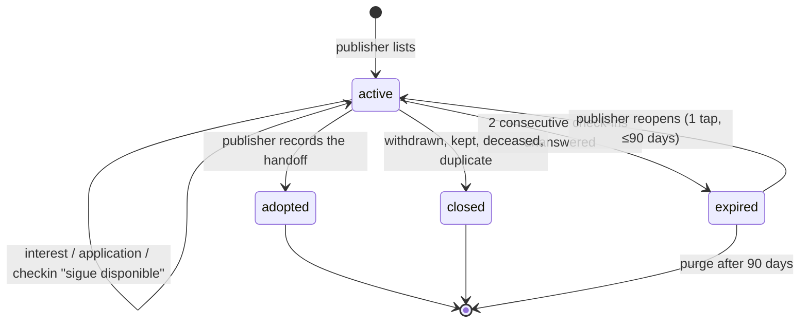

# Adoption Workflow — States & Domain

> The ADOPCIÓN vertical. Companion to [04-lost-workflow_draft_1.md](04-lost-workflow_draft_1.md) and
> [05-found-workflow.md](05-found-workflow.md), and the first one that breaks their shape.
> **Posture: we mediate contact. We never hold the transaction.** No contracts, no escrow, no
> adjudication, no home visits — decision 8 in [00-product-map.md](00-product-map.md) and the
> intermediary line in [03-legal-colombia.md](03-legal-colombia.md).
> Domain identifiers are English/snake_case; Spanish strings are UI copy.

## Scope: P2P now, B2P by extension

**v1 ships person-to-person only.** One individual rehoming one animal, talking to another
individual. No organization accounts, no screening form, no ranked inbox, no foundation onboarding.

**B2P — a foundation listing twenty pets to a queue of applicants — is a planned second lane, not a
rewrite.** Everything below is designed so that adding it is *filling in values and building one
view*, never migrating data or re-cutting the model. That's principle 1 from
[00-product-map.md](00-product-map.md) applied at the schema level: build wide, launch narrow.

### The seams, and what they cost today

| Seam | v1 | What B2P adds | Cost of pre-wiring |
|---|---|---|---|
| `created_by` | Always a person | An organization publishes | Reference the **actor**, not a `person_id` FK. The `responsibility_link` in [01](01-actors-and-entities.md) already has `role: org` |
| `adoption_case.lane` | Enum with one legal value: `light` | `application` becomes legal | One column, one check constraint. Nothing branches on it yet |
| `adoption_request.kind` | Only `interest` | `application` becomes legal | Same |
| `adoption_request.form_data` | Nullable, never written | The screening answers land here | A nullable JSON column |
| `requirements` | Structured flags, entered by an individual | The same flags become **filters** across many listings | Free text alone would be the trap — it can't be filtered later |
| The inbox | A list of 3 requests with real statuses | Sorting, filtering, ranking over 40 | Build the list as a *list with state transitions*, never as a chat thread |
| `publisher_tier` | `phone_verified` \| `unverified` | `org_verified` (personería jurídica) is one more value | An enum, displayed from day one |
| `resolution_attribution` | Same values | Same values | Nothing |

### What we deliberately do **not** build yet

Ranking algorithms, per-foundation custom questions, bulk CSV import, org dashboards, seats and
permissions, and the public response-time label ([see below](#ghosting-runs-both-ways)). None of these
constrain the model, so none of them earn v1 hours.

> **The one open risk of P2P-first:** [00-product-map.md](00-product-map.md) counts foundation
> listings as day-one inventory so the feed never looks empty, and calls adoption "the inventory
> engine." P2P-only removes that. The mitigation already exists in the model — `converted_to_adoptable`
> from [05](05-found-workflow.md) turns found strays into adoption listings published by individuals,
> which is exactly P2P inventory generated by the vertical we're launching first. If that flow doesn't
> produce enough listings within a couple of months, B2P stops being Phase 2 and becomes urgent.

**On "just contact between two people":** it removes the *transaction* — no adoption contract, no
platform-run process, no verdict from us. That holds in both lanes and forever. What B2P adds later is
a better inbox, never a heavier handoff.

---

## Why this isn't LOST or FOUND

| | LOST / FOUND | ADOPTION |
|---|---|---|
| The clock | Days. Urgency is the product | **None.** A good adoption takes weeks and should |
| The enemy | Time | **Decay and ghosting** — stale listings, unanswered applicants |
| Transferring the animal | The risk to prevent (a stranger taking a pet) | **The goal.** We cannot gate what we're trying to cause |
| Volume of responders | Many, cheap, informational | Few, expensive, each one a real conversation |
| Ending | One case, one resolution | The pet may come back and be listed again |
| Real question | "Where is this animal?" | "Is this the right home, and is this post still true?" |

The third row is the design driver. In FOUND, handing an animal to a stranger is the failure mode we
build against. In ADOPTION it is the *intended outcome*, so the safety tooling cannot be a gate — it
can only be **signal handed to the person who decides**. That person is never us.

## The flow, in one pass

```
person ──lists──▶ adoption_case (active) ──▶ feed · filters · shareable card
                          │
                          ├── "Me interesa" → adoption_request(interest)        ← v1
                          │         └──▶ shortlist ──▶ accepted ──▶ real world ──▶ adopted
                          │
                          ├╌╌ "Postularme"  → adoption_request(application)     ← B2P, same table
                          │
                          └── check-ins ──▶ "sigue disponible"  ──▶ active
                                            silence             ──▶ expired
```

---

## The organizing split: the publisher picks the lane

LOST splits responders by what they know. FOUND splits publishers by what they hold. ADOPTION splits
by **how much the publisher is willing to ask of a stranger before talking to them**:

| | **Light lane** — "Me interesa" | **Application lane** — "Postularme" |
|---|---|---|
| Status | **v1** | **B2P, deferred** |
| Typical publisher | An individual rehoming one pet | A foundation with 20 listings |
| Responder gives | A message + three chips + what's on their profile | The screening form: housing, experience, household, other pets |
| Publisher gets | A conversation | A ranked, filterable inbox |
| Why they'd choose it | One pet, three inquiries — a form is overkill and scares people off | Forty inquiries — a conversation each is impossible |
| Falls out of | [05](05-found-workflow.md)'s `converted_to_adoptable`, individual rehoming | Foundation onboarding |

**The publisher chooses; the account type only sets the default.** This rule is written now and
enforced later: when B2P arrives, a foundation rehoming a long-timer may want the light lane to lower
friction, and an individual burned by twenty tire-kickers may want the form. Hard-coding lane to
publisher type would be the easy mistake — and it's the mistake that a P2P-only v1 makes almost by
accident, if `lane` never exists as a field because there's only one of them today.

Both lanes are **the same table** — `adoption_request` with `kind: interest | application`. One
inbox, one state machine, one set of events; the form data is a nullable JSON blob. Two tables here
would double every downstream feature (ranking, notifications, ghost detection) for no gain — and
building the second table later is precisely the migration this design exists to avoid.

---

## Entities

### `adoption_case`
| Field | Notes |
|---|---|
| `pet_id`, `created_by` | An **actor** reference — person in v1, organization once B2P lands. Never a bare `person_id` |
| `publisher_tier` | `unverified \| phone_verified` in v1; `org_verified` joins the enum with B2P. Denormalized and always displayed |
| `lane` | `light \| application` — only `light` is legal in v1. Default from publisher type, publisher can switch |
| `requirements` | Free text **plus** structured flags: `needs_yard`, `no_small_children`, `no_other_dogs`, `indoor_only`, `experienced_home`. The flags are what become filters at B2P scale; free text alone can't |
| `temperament`, `story` | The story is what actually converts; give it room |
| `health_status` | Sterilized, vaccinated, dewormed, chip — and `special_needs` (see below) |
| `fee_cop`, `fee_covers[]` | **Disclosure is mandatory, including zero.** See the fee rule |
| `location_point` | Fuzzed to ~200 m in public, same as every other pin |
| `contact_prefs` | Same shape as the other verticals |
| `predecessor_case_id` | Set when this came from a `found_case` — the cross-vertical bridge |
| `status`, `resolution`, `resolution_attribution` | See state machine |
| `published_at`, `next_checkin_at`, `resolved_at` | |

### `adoption_request` — "Me interesa" / "Postularme"
`adoption_case_id`, `kind: interest | application` (only `interest` legal in v1),
`applicant_person_id` (**never anonymous**), `message`, `chips[]`, `form_data?` (nullable, unwritten
until B2P), `created_at`, `first_responded_at?`,
`status: open | shortlisted | accepted | declined | withdrawn | lapsed`.

The full status set ships in v1 even though a person with three inquiries barely needs `shortlisted`.
It costs nothing, it's what makes the v1 inbox a **list with state transitions instead of a chat
thread**, and that distinction is the entire difference between adding B2P ranking later and
rebuilding the surface.

`lapsed` is first-class and is the point of the whole entity: the applicant stopped answering after
being accepted. Modeling ghosting as a real terminal state is what lets the pet return to the feed
automatically instead of sitting reserved forever, and what lets us count how often it happens.

`first_responded_at` powers the response-time label. See the ghosting rules.

### `pet.health_flags[]` (extension to [01](01-actors-and-entities.md))
`chronic_condition` · `special_needs` · `senior` · `fiv_felv` · `mobility_aid` · `behavioral_support`.

A condition is a **property of the animal, not a case** — it survives every adoption, and it is the
join to [07-help-workflow.md](07-help-workflow.md). It is also a filter adopters actively search on:
special-needs adopters exist, they self-select, and they are the best homes on the platform. Surface
the flags, never bury them.

### `report` (reused)
Defined in [04](04-lost-workflow_draft_1.md#report--anyone-can-report-a-publication). The reason that
matters here is `scam_or_extortion` — see the sale-disguised-as-adoption rule.

---

## The reservation inversion

[04](04-lost-workflow_draft_1.md) rules that a recovery claim must **never** reduce reach. Here the
opposite is correct, and the difference is worth stating so nobody "fixes" it later:

> A lost case competes with time; suppressing it kills a search.
> An adoption case competes with **attention**, and attention spent on a pet that is already
> spoken for is attention stolen from the other 19 pets in the feed.

So an accepted request demotes the listing in ranking and shows «Apartado». But it does **not** close
it, because reservations fall through constantly — the applicant ghosts, the landlord says no, the
resident dog says no. The second-choice applicant is the person who saves that adoption, so the
listing keeps accepting requests with honest copy:

> «Nube está apartada, pero las adopciones a veces no se concretan.
> Puedes postularte como segunda opción.»

`reserved` is therefore **not a status** — it's `EXISTS adoption_request WHERE status = 'accepted'`,
a badge and a ranking weight. Same discipline as the other verticals.

---

## Case state machine



Four statuses: `active` · `adopted` · `expired` · `closed`. Retention is 90 days rather than 30 —
adoption timelines are months, and a listing that expired in December is genuinely likely to be
reopened in February.

| Rejected state | Why it's derived instead |
|---|---|
| `reserved` | `EXISTS request WHERE status = 'accepted'`. A badge and a ranking weight — see above |
| `pending_home_visit` | The real world is off-platform by decision. We do not model a process we cannot observe |
| `draft` | Same as [04](04-lost-workflow_draft_1.md): one screen. Bulk-listing foundations get CSV import, not drafts |
| `returned` | An adoption that comes back is a **new case** on the same pet, with `predecessor_case_id`. The first adoption really did happen; erasing it loses the history that is the whole point of the pet-centric model |

---

## The follow-up loop

The third framing in three verticals, and the set is now complete:

| Vertical | The lever | Why |
|---|---|---|
| LOST | Loss aversion — «se archivará en 5 días» | The owner has something to lose |
| FOUND | The animal's future — «¿publicar en adopción?» | The finder doesn't; the animal does |
| **ADOPTION** | **The people waiting** — «3 personas preguntaron por Nube» | The publisher has neither a loss nor a deadline. What moves them is that real humans are hanging |

> «3 personas preguntaron por Nube esta semana. ¿Sigue disponible?»
> `[ Sigue disponible ]  [ Ya fue adoptado 🎉 ]  [ Ya no está disponible ]`

Naming the count is the mechanic. «¿Sigue disponible?» alone is a chore; "three people are waiting on
you" is an obligation — and if the count is zero, the check-in is a good moment to suggest better
photos instead.

| Trigger | Cadence |
|---|---|
| Time-based | T+14d, then every 14 days — far slower than LOST's 7 or FOUND's 5 |
| Unanswered `adoption_request` older than 5 days | A nudge, not a check-in: «tienes 3 postulaciones sin responder» |
| An `accepted` request with no outcome after 21 days | «¿Cómo va la adopción de Nube?» → `adopted` / `sigue en proceso` / `no se concretó` |
| Any publisher interaction | Resets `next_checkin_at` |

Two consecutive unanswered check-ins ≈ 28 days of silence → `expired`.

### Ghosting runs both ways

Both directions are measured, and both are visible in exactly the right place:

- **Publisher → applicant.** `first_responded_at` is recorded from day one. The **public** label it
  powers — «Suele responder en 2 días» — waits for B2P: it's the strongest incentive we can apply to a
  foundation without nagging them, but over one listing and three inquiries the average is noise, and
  publishing noise as a stat is worse than publishing nothing. In v1 the same data drives a private
  nudge: «tienes 3 postulaciones sin responder». Same column, same event, label switched on later.
- **Applicant → publisher.** An accepted request with no movement auto-`lapsed` after 14 days, which
  frees the pet. Repeated lapses across listings lower the applicant's ranking weight — quietly, and
  never shown to other publishers as a score. We surface behavior, not verdicts.

---

## The adopter-intent problem

Every vertical has one high-stakes vector. LOST's is a false «lo tengo». FOUND's is a false «es mío».
Adoption's is worse in kind: **the person asking to take the animal is supposed to take the animal**.
There is no claim to verify. The dangerous adopter and the perfect adopter file identical requests.

So there is no gate. There is only signal, and one honest disclosure:

### Rule: fee disclosure is mandatory, including zero

`fee_cop` cannot be left blank. A foundation's **cuota de recuperación** — covering sterilization,
vaccines, deworming — is legitimate and normal in Colombia, and hiding it wastes everyone's time when
it surfaces in the DMs. Rendered plainly:

> «Cuota de recuperación: $150.000 — cubre esterilización, vacunas y desparasitación»
> «Sin cuota»

The fee is **display-only and never passes through the platform** (principle 2). Making it structured
also makes "adoption" listings that are really puppy sales visible as data — a fee far above the
local norm, no `fee_covers` entries, an unsterilized litter of the same breed — which is a moderation
query, not a human reading posts.

**P2P raises the stakes on this rule, not lowers them.** A foundation charging a recovery fee has an
institution and a personería jurídica behind the number. An individual charging one has nothing behind
it, and "adopción con cuota" is the standard cover for a breeder selling puppies. So in v1 the
expected value is zero: a non-zero fee on an individual listing requires `fee_covers` entries, shows
what it covers next to the amount, and above a threshold routes to the moderation queue on publish.
Not blocked — plenty of legitimate rehomers ask for the sterilization cost back — but never silent.

### The signals we hand the publisher

In a P2P-only v1 this matters *more*, not less. A foundation at least applies its own process — home
visits, interviews, a person who has done this two hundred times. An individual rehoming their dog has
none of that, so the signals below are the only screening in the system.

| Signal | What it is |
|---|---|
| Trust tier | `unverified` vs `phone_verified` in v1; the Verified badge (principle 3) joins at B2P |
| Account age and history | Sightings reported, cases published — real participation is hard to fake in bulk |
| Requests across listings | The **collector signal**: 9 open requests across 9 pets in three weeks is a pattern worth showing |
| Lapse history | "Accepted twice before and disappeared" |

Presented as facts next to the request, never as a score, a rating, or a recommendation.

### Rule: the platform never approves an adopter

Same rule as FOUND's ownership adjudication, for the same reason. We rank, we disclose, we warn. The
publisher decides, and the ToS says so. Anything else makes us liable for who gets an animal, and
pulls the adoption contract we deliberately deferred in [03](03-legal-colombia.md) into v1.

---

## `resolution` values

| Value | Meaning | Side effect |
|---|---|---|
| `adopted` | Handoff happened | **Responsibility link transfers** — publisher's link closes, adopter's `owner` link opens; pet becomes `claimed` |
| `kept_by_publisher` | Foster failed, in the good way | Link converts to `owner` |
| `withdrawn` | No longer available, no adoption | |
| `deceased` | | Pet record survives; every case closes |
| `duplicate` | | Merge, reversibly |

`adopted_by_person_id` is **nullable** — plenty of adopters arrive from Instagram, see the listing,
and never make an account. Forcing the field would make publishers lie. Instead, ask the same question
LOST asks at reunion: `adoption_attribution: platform_application | platform_interest |
platform_share | offline | unknown`. That's how "foundations actively listing" becomes a number we can
report honestly instead of guess at.

---

## Cross-vertical bridges

1. **FOUND → ADOPTION.** `converted_to_adoptable` creates this case on the *same pet*, with
   `predecessor_case_id` set. The photos, the traits, and «encontrado en el barrio Laureles en junio»
   all survive into the listing — the thing a Facebook group structurally cannot do.
2. **ADOPTION → HELP.** A listed pet with `health_flags` can carry an open `help_case` for its
   treatment; see [07-help-workflow.md](07-help-workflow.md). "Adoptable, and here's what his surgery
   still needs" is one of the most compelling posts the platform can produce.
3. **ADOPTION → LOST.** The adopter is now the owner, so if the pet goes missing a month later they
   publish a lost case as owner with no special casing. This falls out of the model for free and is
   the best proof it's the right one.
4. **Return.** A new adoption case on the same pet, `predecessor_case_id` set. Whether the previous
   adoption is *shown publicly* is [open question 3](#open-questions) — the honest answer helps
   matching and can stigmatize the animal.

---

## Identity ladder for this vertical

| Action | Anonymous | Registered |
|---|---|---|
| Browse, filter, share the card | ✓ | ✓ |
| Contact the publisher | ✓ — WhatsApp deep link | ✓ — WhatsApp or in-app thread |
| Report a publication (abuse) | ✓ — one tap, reason required | ✓ |
| **"Me interesa"** | ✗ | ✓ — always, no exceptions |
| Publish an adoption case | ✗ | ✓ — OAuth + phone verified (person in v1; organization at B2P) |
| Earn points / attribution | ✗ | ✓ |

The publisher is handing over an animal; they get to know who is asking. This is the one place where
the anonymous-helping principle doesn't apply, because the anonymous party isn't helping — they're
receiving.

---

## Events

`adoption_case.published` · `adoption_case.reopened` · `adoption_request.created` (interest |
application) · `adoption_request.first_response` · `adoption_request.shortlisted` ·
`adoption_request.accepted` · `adoption_request.declined` · `adoption_request.lapsed` ·
`contact.opened` · `checkin.sent` · `checkin.responded` · `report.submitted` ·
`adoption_case.adopted` · `adoption_case.expired` · `adoption_case.closed` ·
`pet.custody_transferred` · `pet.relisted`

---

## Open questions

| # | Question | Recommendation |
|---|---|---|
| 1 | Does the light lane need *any* structure, or is a free message enough? | Free message + three optional chips («tengo patio», «tengo otros perros», «primera mascota»). Chips are answerable in one tap and give the publisher 80% of the form's signal — and they're the v1 stand-in for the screening form |
| 2 | **What actually triggers B2P?** | Two signals, either one: the adoption feed can't stay stocked from `converted_to_adoptable` alone, or a foundation asks us for the inbox unprompted. Don't build it on a schedule — build it on one of those |
| 3 | Should the screening form be ours or per-foundation? | Ours, shared, when it lands — a shared base form is what makes the inbox rankable and comparable. Per-foundation custom questions are an append after that, never a replacement |
| 4 | Show publicly that a pet was returned from a previous adoption? | Show it to the **publisher** always; show it publicly only as neutral history («busca hogar por segunda vez»), never as a reason. Honest, and it filters for adopters who can handle the truth |
| 5 | Cap concurrent open requests per applicant? | No hard cap — a serious adopter legitimately asks about three pets. Surface the count to publishers instead. Revisit if the collector pattern shows up in moderation |
| 6 | Does P2P-only need *more* safety copy than B2P would? | Yes. With no institution on either side, v1 should carry explicit handoff guidance — meet in a public place, never pay before meeting the animal, ask for the vet's name. Copy, not process |
| 7 | Adoption contract template as a foundation value-add | Still deferred, per [03](03-legal-colombia.md). Offering a template edges us toward the transaction; if foundations ask at B2P, ship it as a downloadable PDF we neither store nor witness |
| 8 | Waitlist a specific adopter for future pets matching a filter? | Later, and genuinely good — «avísame cuando llegue un gato adulto tranquilo» is a demand signal the feed can't express. Worth more in a thin P2P feed than in a stocked B2P one |
