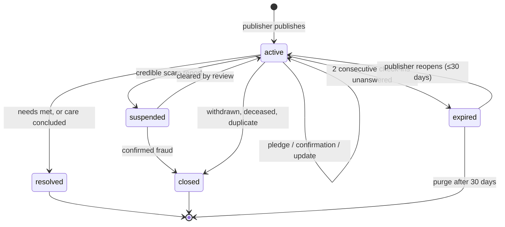

# Help Workflow — States & Domain

> The AYUDA vertical: an animal has a condition and needs something it isn't going to get on its own.
> Supersedes the "Donations (Phase 2)" sketch in [02-flows.md](02-flows.md) and
> [00-product-map.md](00-product-map.md) — **help is a superset of donations**, and the money case
> turns out to be the hardest instance of a more general shape, not the shape itself.
> Domain identifiers are English/snake_case; Spanish strings are UI copy.

## Help is not only money

The reflex is to build a donation feature. That is one need out of eight, it's the one with the worst
fraud profile, and it's the only one a stranger two blocks away usually *can't* satisfy:

| `need_kind` | Ask | Who can give it |
|---|---|---|
| `funds` | Surgery, treatment, medication | Anyone, from anywhere — and the hardest to verify |
| `transport` | «Necesito llevarlo al veterinario el martes» | A neighbor with a car. Free to give, blocks everything when missing |
| `foster` | A home for 3 weeks post-op, or while the owner is hospitalized | Rare, high-commitment, enormous |
| `supplies` | Medication, a crate, a wheelchair, food, cone | Anyone with leftovers. The lowest-friction help that exists |
| `blood` | Canine/feline donor, same city, within hours | A specific dog. Scarce and unbuyable — no marketplace covers this |
| `rescue` | An injured animal on the street **right now** | Whoever is physically nearest. See the two shapes |
| `vet_access` | A clinic that will see this case at a reduced rate | Onboarded vets (Phase 2 actor) |
| `hands` | Post-op care, daily medication, walks for a recovering dog | A neighbor with twenty minutes a day |

The design consequence: **money must not be the primitive.** If we build "campaigns," transport and
blood become bolt-ons forever. If we build a general need with a ledger, funds is just the instance
whose unit is pesos.

## The flow, in one pass

```
publisher ──publishes──▶ help_case (active) ──▶ broadcast (geo push if urgent · feed · card)
                              │
                              ├── need(funds)     ──▶ pledge ──▶ beneficiary confirms received
                              ├── need(transport) ──▶ pledge ──▶ beneficiary confirms delivered
                              ├── need(foster)    ──▶ pledge ──▶ beneficiary confirms delivered
                              │
                              └── check-ins ──▶ «¿cómo va?» ──▶ update to helpers (mandatory)
                                                silence      ──▶ expired
```

---

## The organizing insight: every need is a pledge ledger

Whatever the unit — pesos, a ride on Tuesday, three weeks of foster, a bag of gabapentin — the shape
is identical:

```
need(kind, target_amount?, unit) ──▶ pledge(helper, amount?, note) ──▶ confirmation(beneficiary)
```

One entity, one progress model, one reputation signal. And because **money never touches the
platform** (principle 2, non-negotiable), a pledge is *all we can ever honestly know about a
donation anyway*. What looks like a limitation is actually the unification: we were never going to be
able to observe pesos moving, so we model every kind of help exactly as well as we model money —
someone said they would, and the beneficiary said whether it arrived.

### The two numbers rule

> A campaign shows **two numbers, never one**: *confirmado* — what the beneficiary says arrived —
> large and primary; *prometido* — what people pledged — small, secondary, and labeled as such.

A single self-reported "raised" figure is the donation scam's favorite instrument: fabricated progress
manufactures the social proof and urgency that pull real money in. Splitting the number costs the
honest publisher one tap per pledge and costs the dishonest one their best tool. It also makes
`confirmed / pledged` a fraud signal we can query — a case collecting pledges and confirming nothing
is the pattern.

### The two shapes

| | **Urgent field help** | **Sustained care** |
|---|---|---|
| Example | Injured dog on Calle 45, right now | Rocky's hip surgery, $2.4M, over three weeks |
| Custody | Usually **nobody** — it's on the street | Publisher holds the animal |
| Pet record | `unclaimed`, created on the spot, minimal | Existing pet, often already known to the platform |
| Broadcast | **Geo push, tight radius, LOST machinery reused** | Feed + shareable card; push only to followers |
| Clock | Minutes to hours | Days to weeks |
| Typical resolution | Someone picks it up → becomes a `found_case` | Treatment happens, or it doesn't |
| Fraud risk | Near zero — nobody scams you into driving somewhere | **The highest in the product** |

Same table, two profiles. `urgency: now | days | ongoing` drives broadcast and cadence; it is not a
separate entity.

### The custody triangle is now complete

| Vertical | Who holds the animal | Who's in danger of what |
|---|---|---|
| LOST | Owner knows it, nobody holds it | The pet is missing |
| FOUND | The finder holds it | Custody limbo with a deadline |
| **HELP (`rescue`)** | **Nobody holds it, and it can't wait** | The animal is in immediate danger where it stands |

That third position is the gap in the current product map. A person who sees a dog hit by a car
cannot file a lost report (not theirs), cannot file a found report (they aren't taking it), and a
stray sighting is far too quiet for what's happening. `help_case(rescue)` is that missing verb, and it
reuses the geo-push machinery [04](04-lost-workflow_draft_1.md) already pays for.

---

## Entities

### `help_case`
| Field | Notes |
|---|---|
| `pet_id`, `created_by` | Person or org, account + phone verified. `rescue` creates an `unclaimed` pet |
| `urgency` | `now \| days \| ongoing` — drives broadcast channel and check-in cadence |
| `condition_summary` | Plain language, publisher's words |
| `point`, `point_meaning` | `where_the_animal_is` for `rescue`; **`approximate_only` for everything else** |
| `beneficiary` | Who receives the help — publisher, or an org, or a **clinic** |
| `trust_tier` | Denormalized for display. Never hidden, never softened |
| `status`, `resolution` | See state machine |
| `predecessor_case_id`, `successor_case_id` | Bridges to found / adoption cases |
| `published_at`, `next_checkin_at`, `resolved_at` | |

### `need` — one row per thing required
`help_case_id`, `kind`, `unit: cop | trips | nights | items | ml | hours`, `target_amount?`,
`description`, `needed_by?`, `status: open | met | cancelled`.

A case with three needs (money **and** a ride **and** a foster) is normal and is the case for
modeling needs separately: each closes on its own schedule, and a case whose money is covered but
whose transport isn't is a case that still needs the feed.

`target_amount` is nullable on purpose — «necesitamos quien lo lleve al vet» has no number.

### `pledge` — "yo ayudo"
`need_id`, `helper_person_id?`, `helper_contact?`, `amount?`, `note`, `promised_for?`,
`status: pledged | confirmed | lapsed | withdrawn`, `confirmed_at`, `confirmed_by`.

**Only the beneficiary can move a pledge to `confirmed`.** Same discipline as «only the owner closes a
case as reunited» — the party who benefits from the optimistic number is never the party who sets it.

A pledge auto-`lapsed` after `promised_for + 48h`, or 14 days with no confirmation. Lapsing is not an
accusation: money gets sent and never confirmed all the time. It's what keeps the ledger from
inflating quietly.

`pledge.confirmed` is the **first real signal the points system has ever had** — not "posted a thing"
but "said they'd help and the person on the other end says they did." Points on `pledged` would be
farmable in a minute; points on `confirmed` require a second human to agree.

### `evidence`
`help_case_id`, `kind: vet_diagnosis | invoice | prescription | photo | vet_contact | receipt`,
`file?`, `note`, `issued_at`, `verified_by_operator?`, `verified_at`.

For `need_kind = funds`, at least one of `vet_diagnosis | invoice | vet_contact` is **required to
publish**. This is the one place in the entire product with a hard publish gate, and the exception is
argued below.

### `report` (reused)
Defined in [04](04-lost-workflow_draft_1.md#report--anyone-can-report-a-publication). `scam_or_extortion`
against a funds case is the highest-priority report in the system — see the suspension inversion.

### `pet.health_flags[]` (shared with [06](06-adoption-workflow.md))
A chronic condition lives on the pet and outlives every case. See acute vs chronic below.

---

## Money still never touches the platform

Unchanged and not up for discussion. What *is* new is where we point the money:

### `payout_target: person | organization | clinic`

`clinic` is the quiet answer to almost all donation fraud. When the beneficiary is an onboarded vet
clinic and donors pay the clinic against a specific case, a fabricated campaign has nowhere to land —
you cannot steal a surgery. It requires no payment integration on our side, only a clinic willing to
receive earmarked payments, and it earns the strongest label we can offer:

> 🏥 «Los aportes van directo a la clínica, no a una persona.»

Individuals stay allowed — most cases are one person with a hurt dog and a Nequi number, and refusing
them would gut the vertical. But the clinic route is ranked higher, labeled better, and is the
default we nudge toward. This is the Phase 2 vet actor from
[00-product-map.md](00-product-map.md) earning its keep well before a directory does.

### Rule: the publish gate on funds cases

Every other case in this product publishes instantly. A `funds` need does not: it requires evidence
and it shows a trust tier. The asymmetry is deliberate —

> A fake lost case wastes attention. A fake funds case takes money from people who gave it out of
> compassion, and it takes their willingness to ever give again. That second loss is the one that
> kills the platform, and it is not recoverable by moderation.

The gate is evidence-attached, **not** operator-reviewed — publishing still takes minutes, not days.
Operator review is what upgrades the badge, not what unlocks the post.

### Rule: we label, we never guarantee

Verbatim from [03-legal-colombia.md](03-legal-colombia.md): a badge means "we reviewed a document,"
never "we vouch for this campaign." Copy on every funds case, not in a footer:

> «Este aporte va directo a la persona o clínica beneficiaria. Scuby no recibe ni administra dinero,
> y no puede garantizar el uso de los fondos.»

---

## Case state machine



Five statuses — the only vertical that gets a fifth, and the argument for it is the deliberate
inversion of a rule from [04](04-lost-workflow_draft_1.md):

> **LOST:** a report must never hide an active case, because a stranger could silently kill a search.
> **HELP:** a credible scam report on a funds case **suspends it immediately**, because every hour a
> fraudulent campaign stays up converts strangers' compassion into a stranger's income, and no amount
> of later moderation gets that money back.

The costs are asymmetric, so the defaults are opposite. Suspension is loud, not silent: the publisher
is told why, given a channel to respond, and reviewed against an SLA. `suspended` is visible on the
case as «en revisión» — hiding a case with pledges outstanding while telling helpers nothing would be
its own kind of dishonesty.

Non-funds needs (`transport`, `supplies`, `hands`) keep the LOST default: reports queue, the case
keeps running. Nobody is defrauded by a ride.

---

## The follow-up loop

The fourth framing, and the only one aimed at someone other than the publisher's own interest:

| Vertical | The lever |
|---|---|
| LOST | Loss aversion — the post disappears |
| FOUND | The animal's future |
| ADOPTION | The people waiting |
| **HELP** | **Accountability to the people who already gave** — «12 personas aportaron. ¿Cómo va Rocky?» |

> «12 personas aportaron para Rocky. Ellos quieren saber cómo va.»
> `[ Publicar una actualización ]  [ Ya se resolvió 🎉 ]  [ Cerrar el caso ]`

### The update is mandatory, and it's the product

An `update` — text plus a photo, optionally an invoice — is not a nice-to-have. It is:

1. **The anti-fraud mechanic that scales.** A real case produces photos of a shaved leg, a cone, a
   discharge sheet, week after week. A fake one produces silence or recycled images. No review queue
   in the world catches fraud as reliably as a required weekly update does.
2. **The reason anyone gives twice.** Giving into a void trains people to stop giving. Every helper
   who pledged is notified on every update — that's the loop that makes the second campaign work.
3. **The best content the platform produces.** A dog walking again is the post that recruits the next
   thousand users, and it costs us nothing to generate.

A funds case with **no update in 14 days and outstanding pledges** loses feed placement and gets a
public «sin actualizaciones recientes» label. Not a punishment — information the next donor deserves.

| Trigger | Cadence |
|---|---|
| `urgency: now` | T+2h, then T+12h. This is «¿ya lo recogieron?», and it closes fast |
| `urgency: days` | T+48h, then every 5 days |
| `urgency: ongoing` | Every 14 days |
| Any `pledge` confirmed | Nudge for an update within 72h |
| A `need` reaches its target | «¿Ya pudiste hacer el procedimiento?» |

Two consecutive unanswered check-ins → `expired`. **Exception:** a case with outstanding confirmed
pledges never silently expires — it escalates to a human, because people gave money to it.

---

## Acute vs chronic

A `help_case` has a goal and an ending. A three-legged dog with lifelong medication has neither, and
forcing it into a case produces something that can never resolve and check-ins that never stop.

- **Acute need** → `help_case`. Has a target, closes. **This is all of v1.**
- **Chronic condition** → `pet.health_flags[]` + `condition_notes` on the pet. Durable, travels
  through adoption, surfaces as a filter for adopters who want exactly that.
- **Recurring support** → out of scope. It's a subscription in disguise, and money never touches us.

An ongoing condition can still open a *bounded* case («necesita medicación por 3 meses») whenever
there's a specific ask with an end. The distinction is the ask, not the illness.

---

## Cross-vertical bridges

1. **`rescue` → FOUND.** Someone picks the animal up: `successor_case_id` points at a new
   `found_case`, custody begins, the rescue case resolves as `secured`. The most common good ending
   of a rescue is that it becomes somebody's problem in the best sense.
2. **FOUND / ADOPTION → HELP.** An injured stray or a listed pet with `health_flags` opens a help
   case on the same pet, both cases live simultaneously. «Adoptable, y esto es lo que le falta para su
   cirugía» is one of the strongest posts the platform can make.
3. **LOST → HELP.** A pet recovered injured after a week outside. Same pet, the lost case resolves
   `reunited`, the help case opens.
4. **HELP → ADOPTION.** The owner can't keep the animal after all — `converted_to_adoptable`,
   `successor_case_id`, and every pledge, update and photo stays attached to the pet.

Four verticals, one pet record, and every path between them already expressible. That's the payoff
[01-actors-and-entities.md](01-actors-and-entities.md) promised.

---

## Identity ladder for this vertical

| Action | Anonymous | Registered |
|---|---|---|
| View, share the card | ✓ | ✓ |
| Report an animal in danger (`rescue`) | ✓ — pin required, everything else optional | ✓ |
| Contact the beneficiary | ✓ — WhatsApp deep link | ✓ — WhatsApp or in-app thread |
| Report a publication (abuse) | ✓ — one tap, reason required | ✓ |
| Pledge non-money help | ✓ — contact required (a foster we can't reach is not a foster) | ✓ |
| Pledge money | ✓ — donating never requires an account, ever | ✓ — attributable, earns points on confirmation |
| Publish a help case | ✗ | ✓ — OAuth + phone verified |
| Publish a `funds` need | ✗ | ✓ — **+ evidence attached, + trust tier shown** |
| Confirm a pledge as received | ✗ | ✓ — beneficiary only |

`rescue` inherits the sighting rule exactly: a pin is enough. An animal bleeding on the street is the
worst possible moment to ask anyone for a phone number.

---

## Events

`help_case.published` · `help_case.broadcast_sent` · `need.created` · `need.met` ·
`pledge.created` · `pledge.confirmed` · `pledge.lapsed` · `update.posted` ·
`evidence.attached` · `evidence.verified` · `contact.opened` · `checkin.sent` · `checkin.responded` ·
`report.submitted` · `help_case.suspended` · `help_case.cleared` ·
`help_case.resolved` · `help_case.expired` · `help_case.closed` · `pet.health_flag_added`

---

## Open questions

| # | Question | Recommendation |
|---|---|---|
| 1 | Is `rescue` really this vertical, or its own? | Here. It shares the pledge ledger («yo voy», «yo lo llevo») and reuses LOST's geo push. Splitting it duplicates both for one field's difference |
| 2 | Show a progress bar at all, given money is off-platform? | Yes — but on **confirmed**, with pledged as a faint secondary. A bar on self-reported totals would be us rendering a number we have no basis for |
| 3 | Vet onboarding is Phase 2, but `payout_target: clinic` is the best fraud control we have | Pull *one* clinic into the pilot early. One friendly vet unlocks the highest trust tier and proves the model before any directory work |
| 4 | Who reviews the suspension queue, and how fast? | Same operators as [04 q7](04-lost-workflow_draft_1.md#open-questions), tighter SLA: suspended funds cases ≤4h. A suspension nobody reviews is a takedown |
| 5 | Blood donation — genuinely useful or a novelty? | Real and unbuyable, but it needs vet supervision to be safe. Ship it as `need_kind = blood` with the clinic named and the logistics between clinic and donor. Never person-to-person |
| 6 | Should lapsed pledges be visible publicly? | No. Show the beneficiary «3 promesas sin confirmar»; publishing them shames helpers for a system delay and chills pledging |
| 7 | Cap `target_amount`? | Soft threshold: above ~5M COP, require operator review before the case leaves the local feed. Large asks are where organized fraud lives, and it's the cheapest place to spend review time |
| 8 | Can a helper give anonymously but still be thanked? | Yes — `helper_person_id` set, display name hidden. Recognition and publicity are different things, and plenty of donors want the first without the second |
