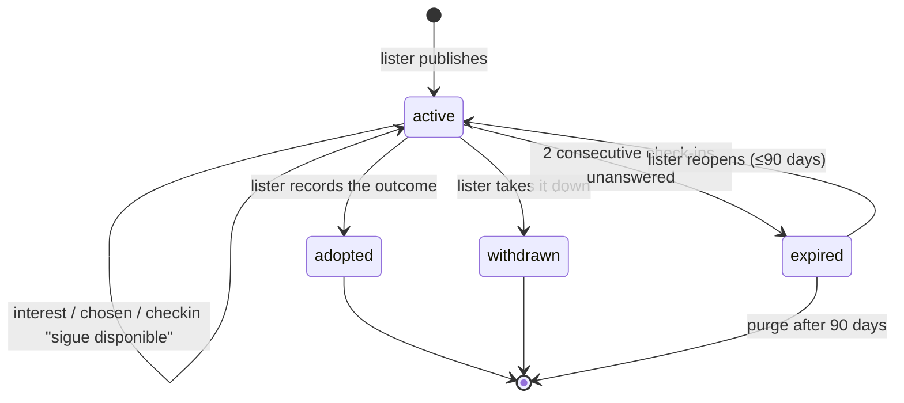

# Adoption Workflow — States & Domain

> The ADOPCIÓN vertical. Source of truth for the adoption flow; where it disagrees with earlier
> docs, this one wins and the others get patched. Reuses the machinery in
> [04](04-lost-workflow.md) and [07](07-found-workflow.md) — `case_checkin`, the
> row-before-channel rule, location precision — and says so instead of restating it.
> Domain identifiers are English/snake_case; Spanish strings are UI copy.

## The flow, in one pass

```
lister ──publishes──▶ adoption_case (active) ──▶ feed (by proximity) · shareable card
  person or org                  │
                                 ├── «Me interesa» → adoption_interest (intro + channel)
                                 │         lister: list of interests → chosen → adopted
                                 │
                                 └── check-ins ──▶ lister answers ──▶ adopted | withdrawn
                                                  lister silent  ──▶ expired
```

## The organizing insight

**v1 adoption is a listing vertical, not a screening vertical.** The people we serve first are
individuals — an owner rehoming, a rescuer, the custodian from the found flow who can't keep the
stray — and they screen adopters in chat, as they do today on Instagram. Foundations with their own
process get a listing that links out to it. The ranked, filterable application inbox from the
original sketch is deferred until a foundation has moved its process to us and asks for it.

What we add over an Instagram post: a listing with reach and continuity (a found stray becomes an
adoptable listing on the *same* pet row), an interest row before every conversation so the lister
sees who is interested without reading forty chats, and a recorded outcome that transfers
responsibility to a real person.

**The B2P seams ship in v1** so the foundation inbox is "enum values plus one view, never a
migration": `adoption_case.lane: light | application` (only `light` legal in v1, nothing branches
on it yet), `adoption_interest.kind: interest | application`, a nullable `form_data` JSON column
that stays unwritten until the screening form exists, `created_by` referencing the **actor**
(person or org), and requirement *flags* rather than free text alone — flags can become filters
across twenty listings; prose can't.

---

## Entities

### `pet`
Already exists — the lister holds it. `custody_state` is whatever it was: `claimed` (owner
rehoming), `unclaimed` (custodian with a stray), `org_held` (org). Listing changes nothing on the
pet; only the outcome does.

**`health_flags[]`** live on the pet, not the case: `chronic_condition` · `special_needs` ·
`senior` · `fiv_felv` · `mobility_aid` · `behavioral_support`. A condition survives every adoption
and travels with the animal; on listings the flags render prominently and act as filters —
special-needs adopters exist, self-select, and are the best homes on the platform. Surface the
flags, never bury them. (Also the join to the help vertical: [09](09-help-workflow.md).)

### `responsibility_link`
The lister's link is whatever it already is — owner, custodian, or org. **Listing does not touch
it.** `adopted_in_app` is the canonical responsibility transfer: lister's link closes, a new
`role = owner` link opens for the adopter, pet becomes `claimed`, history rides along.

### Organization — what this flow needs from it
It exists, it's verified (personería jurídica reviewed — the trust tier), it can set a **business
WhatsApp number** on its profile that overrides the account phone for all its listings, and its
listings carry the `verified` badge. Nothing else. Inboxes, members, roles: not v1.

### `adoption_case`
| Field | Notes |
|---|---|
| `pet_id`, `created_by` | Lister is registered (person or org) and holds the pet |
| `predecessor_case_id?` | Set when the listing was born from a found case's day-15 conversion ([07](07-found-workflow.md)) — the form arrives pre-filled with the pet's photos, traits, and «encontrado en el barrio Laureles en junio». The primary source of v1 inventory |
| `story` | Free text — the post |
| `temperament[]` | Chips describing the **animal**: `good_with_kids`, `good_with_cats`, `good_with_dogs`, `senior`, `puppy` |
| `requirement_flags[]` | Curated enum array describing the **home**: `needs_yard`, `no_small_children`, `no_other_dogs`, `indoor_only`, `experienced_home`. Extending it is adding an enum value — no migration (enum array + GIN in Postgres; a join table if the DB ends up elsewhere). **Curated, never free-form tags** — the moment anyone can invent one, they stop being filters |
| `requirements` | Free text for everything the flags don't say |
| `fee_cop`, `fee_covers[]` | **Disclosure is mandatory, including zero** — see the fee rule |
| `lane` | `light \| application` — only `light` legal in v1 (B2P seam) |
| `location_point`, `location_radius_m` | Where the animal is. Area, not pin; public render floored at 200 m — the lost/found rule |
| `contact_prefs` | `expose_whatsapp`, `expose_email`, `in_app_only` |
| `external_url?` | An org's own application page. Independent of WhatsApp — a lister can have both |
| `trust_tier` | Derived from the lister: `verified` (org with reviewed document) · `individual` (identity only). Rendered as a badge with honest copy: «Publicado por una persona — la verificación es entre ustedes» |
| `status`, `resolution`, `published_at`, `resolved_at` | State machine below. No schedule fields — `case_checkin` rows |

### `adoption_interest` — «Me interesa»
`case_id`, `person_id` (**always registered**),
`intro { housing: casa | apartamento, has_yard: bool, other_pets: text?, household: text?, why: text }`,
`kind: interest | application` (only `interest` legal in v1), `form_data?` (unwritten until B2P),
`status: open | chosen | declined | withdrawn`, `created_at`, `first_responded_at?`.

**One screen, before the channel opens.** Four fields and a free-text «¿por qué este?». Submitting
creates the row, then opens the channel — same row-before-channel rule as every other contact
action, for the same reasons: count, attribution, and the lister's list.

**One interest per person per case.** Tapping again reopens the existing conversation. Withdrawal is
one tap («ya no me interesa»), which is what keeps the lister's list honest.

#### Channel, after the row
| Lister has enabled | What happens |
|---|---|
| One channel only | Redirect straight there — `wa.me` with the intro prefilled, the `external_url`, or the in-app thread with the intro as its first message. No extra tap |
| WhatsApp **and** `external_url` | One sheet: `[ Escribir por WhatsApp ]  [ Aplicar en su sitio ]` |
| In-app only | Thread opens |

For an `external_url` nothing can be prefilled; the interest row is the only record we keep — which
is exactly why the row exists.

Copy shown at the moment the channel opens — the only screening in a P2P handoff is what these two
people do, so the guidance is explicit, both sides:

> To the adopter: «Conoce al animal en persona antes de decidir. Nunca pagues nada antes de
> conocerlo. Pide el nombre del veterinario que lo ha visto.»
> To the lister: «Conoce a la persona antes de entregarlo. Encuéntrense en un lugar público.»

### What the lister sees
Not an inbox. A **list** on their listing: name, city, the four intro fields as chips, when they
applied, and the conversation link. No ranking, no scoring. Next to each name, **facts from the
account, never a verdict**: «miembro hace 8 meses · 2 avistamientos reportados» and «tiene 6
solicitudes de adopción abiertas». The open-requests count is the collector signal — someone
requesting many animals in weeks is invisible to each lister and obvious in the data; we surface
the number and say nothing else. Three actions:

- **Mark as chosen** → `interest.status = chosen`; the listing shows **«En proceso»** publicly.
  It stays open and **demotes in feed ranking** — the deliberate inverse of lost's
  never-reduce-reach rule: an adoption case competes with *attention*, and attention on a pet
  already spoken for is stolen from the other nineteen in the feed. The copy invites backups,
  because reservations fall through constantly: «Nube está en proceso de adopción, pero a veces no
  se concreta — puedes anotarte como segunda opción.» `reserved` is never a status; it's
  `EXISTS interest WHERE status = 'chosen'`, a badge and a ranking weight.
- **«No se concretó»** — manual, the lister's call, never automatic: clears the chosen interest
  (back to `open` or `declined`) and restores full feed visibility. The system's only role is the
  nudge below when a chosen interest sits without an outcome.
- **Decline** → optional, silent to the adopter. If the lister wants to say no, they say it in chat.
- **Record adoption** → «¿Quién lo adoptó?» picks from the list (→ `adopted_in_app`, link
  transfer) or «fuera de la app» (→ `adopted_offline`).

Anything heavier — configurable screening questions, shortlists, stages — is the deferred inbox
([D6](06-open-items.md)).

### `case_checkin`
Reused from 04. Responses: `still_available | adopted | no_longer_available`. **Check-ins are per
case; delivery is per lister; cadence by lister type** (below).

### Rule: fee disclosure is mandatory, including zero

The **cuota de recuperación** — the adopter reimbursing sterilization, vaccines, deworming — is
standard practice in Colombia, for orgs and individual rescuers alike, and it exists whether we
model it or not; unmodeled, it just surprises the adopter in chat. So `fee_cop` cannot be blank:

> «Cuota de recuperación: $150.000 — cubre esterilización, vacunas y desparasitación»
> «Sin cuota»

Display-only, never through the platform (money principle, unchanged). A non-zero fee **requires
`fee_covers[]` entries**; and on individual listings — where there's no institution behind the
number and «adopción con cuota» is the standard cover for a breeder selling puppies — a fee above
the local norm routes to the moderation queue on publish ([12](12-reporting.md)). Never blocked,
never silent. Structured fees also make the breeder pattern a *query* (high fee + no covers +
unsterilized litter of one breed) instead of a human reading posts.

---

## Case state machine



No `cancelled` separate from `withdrawn`: on adoption there is no "false alarm," only "no longer
available," and one exit with a reason covers it. Retention is **90 days**, not lost/found's 30 —
adoption timelines are months, and a listing that expired in December is genuinely likely to be
reopened in February. A returned adoption gets **no special handling**: if it ever happens, the
lister creates a new case like any other.

### `resolution` values
`adopted_in_app` · `adopted_offline` · `kept` · `deceased` · `transferred` · `no_response`

### Rule: `adopted` is a responsibility transfer, recorded honestly
- **`adopted_in_app`** — the adopter is a registered person picked from the interest list. Lister's
  link closes (`active_to = now`), new link `role = owner` for the adopter, pet
  `custody_state = claimed`. The pet's history (found as a stray, listed, adopted) travels with it.
  Fires `responsibility.transferred`.
- **`adopted_offline`** — the adopter isn't on the platform (an org's own process, a friend). Lister's
  link closes; **no new link**; pet `claimed` with no owner link. Recorded as what it is rather than
  faked with a placeholder person.

### Rule: expiry never changes who is responsible
Cross-vertical, stated in [01](01-actors-and-entities.md): a case expiring touches neither
`responsibility_link` nor `custody_state`. The lister's link stays whatever it was. Purge (expired +
30 days) removes the case; it removes the **pet** only if the pet is `unclaimed` with no other case
and no other link — i.e., a found-flow stray nobody vouches for anymore.

---

## The follow-up loop

Stale listings are the plague of every adoption board, so: same negative framing, same machinery.

> «Max sigue publicado en adopción. Si no nos confirmas, archivaremos la publicación en 5 días.»
> `[ Sigue disponible ]  [ Ya fue adoptado 🎉 ]  [ Ya no está disponible ]`

«Ya fue adoptado» leads to «¿quién?» → pick from interests, or «fuera de la app».

### Cadence by lister type

| Lister | Cadence | Delivery |
|---|---|---|
| Individual | T+7d, then every 14d | Per case; several listings batch into one push |
| Org | Every 30d | **One digest per org** covering all active listings as a checklist: «Tienes 12 animales publicados en adopción. Marca los que ya no están disponibles.» Untouched entries count as «sigue disponible» |
| Chosen interest with no outcome, 21d | «¿Cómo va la adopción de Nube?» `[ Ya fue adoptada 🎉 ] [ Sigue en proceso ] [ No se concretó ]` — the manual exit from «En proceso»; nothing un-chooses automatically |
| Open interests unanswered > 5d | Private nudge, not a check-in: «tienes 3 solicitudes sin responder» — powered by `first_responded_at`; the public «suele responder en 2 días» label waits for B2P, where the average stops being noise |

When a check-in fires on a listing with waiting people, the copy names them — «3 personas
preguntaron por Nube esta semana. ¿Sigue disponible?» — because "three humans are hanging" moves a
lister that «¿sigue disponible?» alone doesn't. With zero interest, the check-in suggests better
photos instead.

Slower than lost/found because nothing is urgent — but never silent: orgs are *where* stale listings
come from (forty animals, three adopted last month, nobody took them down). Changing the unit to
"one question per lister" removes the spam without removing the question.

Expiry per listing: `unanswered_streak = 2` — ~28 days of silence for an individual, ~60 for an org.
When an org's whole batch expires at once, that's the right signal: the org has left.

Escalation push → WhatsApp → email on the same row, interaction resets (check-in answers and
explicit actions — marking chosen, recording adoption — not views), `expired` soft and reopenable
for 90 days: otherwise as in 04.

---

## Reach

**Feed** by proximity to `location_point`, national fallback when the local feed is empty, plus the
**shareable card** (photo, EN ADOPCIÓN, zone, link back). **No geo push** — an adoption listing is
not an emergency, and the push budget belongs to lost/found ([O1/O2](06-open-items.md)). A weekly
opt-in digest is deferred ([D7](06-open-items.md)).

---

## Identity ladder for this vertical

| Action | Anonymous | Registered |
|---|---|---|
| View, share the card | ✓ | ✓ |
| «Me interesa» | ✗ | ✓ — OAuth + phone verified, short intro |
| Contact the lister | ✗ — only through an interest | ✓ — WhatsApp, external URL, or thread |
| Publish a listing | ✗ | ✓ — person or org that holds the pet |
| Report a publication (abuse) | ✓ — one tap, reason required ([12](12-reporting.md)) | ✓ |
| Earn points / attribution | ✗ | ✓ |

The only vertical where nothing beyond viewing is anonymous: adopting is a commitment, not a tip,
and the hand-off needs two real identities for the link transfer.

---

## Events

Named only where something consumes them — **N** notification ([05](05-notifications.md)),
**M** metric not derivable from rows, **A** audit. Publishes, withdrawals, declines, check-ins,
resolutions: queries over rows.

| Event | Consumer |
|---|---|
| `adoption_interest.created` | N — lister, coalesced |
| `adoption_interest.chosen` | N — the adopter |
| `contact.opened` `{whatsapp_click \| external_click}` | M — only evidence the contact happened; for `external_url` it is the *only* record after the interest row |
| `contact.opened` `{thread_created}` | N — lister |
| `adoption_case.adopted` | N — everyone else with an open interest |
| `adoption_case.expired` | N — lister, push + email |
| `responsibility.transferred` | A — on `adopted_in_app`; shared with `kept`, `transferred_to_org`, merge. Every change of who is responsible, one event to audit |

Notifications: [`05-notifications.md`](05-notifications.md) → **Adoption**.

---

## Open items

Tracked in [`06-open-items.md`](06-open-items.md):

- **Open** — O8 points: which events earn them, weights, what status displays
- **Deferred** — D6 structured adoption inbox · D7 adoption digest push
