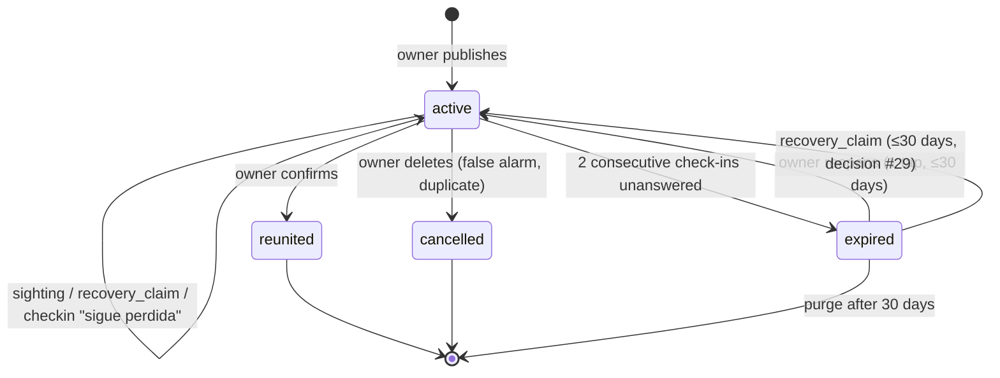

# Lost Workflow — States & Domain

> The PERDIDO vertical, defined from scratch. This document is the source of truth for the lost flow;
> where it disagrees with earlier docs, this one wins and the others get patched.
> Domain identifiers are English/snake_case; Spanish strings are UI copy.

## The flow, in one pass

```
owner ──publishes──▶ lost_case (active) ──▶ broadcast (push · feed · shareable card)
                            │
                            ├── "Lo vi"    → sighting        (many, informational)
                            ├── "Lo tengo" → recovery_claim  (few, custody)
                            │
                            └── system check-ins ──▶ owner answers ──▶ reunited
                                                     owner silent  ──▶ expired
```

## The organizing insight

The neighborhood responds in **two structurally different ways**, and collapsing them into one
"report" is the mistake to avoid:

| | **Sighting** — "Lo vi" | **Recovery claim** — "Lo tengo" |
|---|---|---|
| Semantics | Information: the pet was *here* at *this time* | Custody: someone physically has the pet |
| Volume | High (many per case) | Low (0–2 per case) |
| Trust needed | Low — a wrong pin costs little | High — drives case resolution |
| Product value | The trajectory map on the post | Opening a contact channel, fast |
| Resolves the case? | Never | Only after **owner confirmation** |
| Inputs | pin required; time, contact, photo optional | contact required + pin? + photo? |

Sightings are volume plays; recovery claims are the resolution path. Separate tables, separate rate
limits, separate moderation treatment.


---

## Entities

### `pet`
Created by the system as a side effect of the lost report — the owner never fills a "pet profile"
form. Fields: species, breed_guess, size, colors[], marks, photos[], chip_number, name.

The lost report needs exactly the identification fields a profile needs, so the lost moment onboards
the pet for free — and that row is the one every later vertical attaches to. The publish form
therefore **reuses** before it creates: a user with existing pets sees «¿Cuál se perdió?» with a
picker plus «otra mascota». A second loss of the same animal is a new `lost_case` on the same `pet`.

`custody_state: claimed | unclaimed | org_held`

**A pet is never "lost".** "Lost" is a property of an open case, not of the animal:

```
pet_is_lost := EXISTS case WHERE pet_id = ? AND type = 'lost' AND status = 'active'
```

Derived, never stored twice. This is the most important modeling rule here — storing
`pet.state = 'lost'` guarantees drift the first time a case expires without anyone touching the
pet row.

### `responsibility_link` — person/org ↔ pet
`role: owner | custodian | org`, with `active_from` / `active_to`. Transferable; history survives.

An owner publishing a lost report gets `role = owner` at creation, and **it never changes through
this flow**. Reunion transfers nothing back — nothing was taken away. Custody only moves in the
*merge* path below, where a separate unclaimed record is absorbed.

Ownership is **asserted, not verified**: the link is created by the same action that requires it,
so "lost requires `role = owner`" means "by publishing, you state this is your animal" — and the
form says so («mi mascota»). We cannot verify ownership and don't try. The safeguard is structural:
anyone who isn't the owner has an easier, honest path through Found (below), so there is no reason
to lie through this form. One active `owner` link per pet for now; households sharing a pet is a
later problem.

### `lost_case`
| Field | Notes |
|---|---|
| `pet_id`, `created_by` | Publisher is a registered person (account + phone verified) |
| `last_seen_point`, `last_seen_radius_m`, `last_seen_at` | An **area**, not a pin — see "Location precision" below |
| `contact_prefs` | `expose_whatsapp`, `expose_email`, `in_app_only` |
| ~~`reward`~~ | **No reward field, by design.** People help because it's a lost pet, not for money; a reward field invites fake «lo tengo» claims and makes the platform look like a marketplace. If an owner writes an amount into the description, that's theirs — we don't structure it, show it, or act on it |
| `status` | See state machine |
| `resolution`, `resolution_attribution` | Set on terminal transition |
| `published_at`, `resolved_at` | No `next_checkin_at` — the schedule lives in `case_checkin` rows, never on the case (see below) |

#### Publishing: who, and what gets written

**Only the owner publishes a lost case.** Anyone else goes through «Encontré un animal», whose
first question — «¿Lo tienes contigo?» — routes a person who took the animal home to a found case
and a person who only saw it to a sighting. The lost form is never the place for "I saw a dog that
looked lost"; the model must not force non-owners into the `owner` role because it offered them no
other door.

Publishing writes three rows in **one transaction**: the `pet` (or reuses one, see picker above),
the `responsibility_link` with `role = owner` (or reuses it), and the `lost_case`. A pet without a
link or a case without a pet is a broken state, never a transitional one. Cancelling a case
(`false_alarm`) touches only the case — pet and link survive; the onboarding sticks even when the
scare was nothing.

The publish form includes the **phone step** — verified once, shown prefilled with «cambiar» on
every later publish, re-verified on change: the UI contract lives in
[eng/auth.md](../eng/auth.md) and applies to all four verticals.

#### Contact visibility

What the public card shows of the publisher (decisions #47 and #48 in [00](00-product-map.md)):

- **An unverified phone is never public.** Only the owner sees the number. A «WhatsApp» link on the
  public case needs all of: `expose_whatsapp`, the number marked as having WhatsApp, the number
  **verified**, `in_app_only` off, and an active case. With `publisher_phone_otp` off
  ([eng/auth.md](../eng/auth.md) · Behind a flag) a case publishes with the number unverified and has
  no public phone contact — only «Lo vi» and the in-app thread — until the number is verified.
- **`in_app_only` wins over `expose_whatsapp`** when both arrive: no link.
- **The publisher's public name is never derived from the email.** Until the person has chosen a name
  (typed one, or one supplied by Google), the card shows «Alguien» / "Someone". Once chosen, it is
  shortened as usual («Carolina M.»).

Two invariants enforced at publish:

| Situation | Behavior |
|---|---|
| Selected pet already has an `active` lost case | Block, link to the existing case. Two cases for one animal means two broadcasts and two check-in streams |
| Selected pet has an `expired` case ≤ 30 days old | Offer reopen instead: «Luna ya tenía un aviso — ¿lo reactivamos?». One tap; sightings and trajectory preserved. Publishing fresh is still allowed if the owner declines |

#### Location precision

The owner rarely knows the exact spot — «por ahí cerca del parque» is the honest answer — so the
publish form asks for a point **and a radius**, as preset chips rather than a drag handle:
«~1 cuadra (100 m) · ~3 cuadras (300 m) · ~1 km». Stored as `last_seen_point` +
`last_seen_radius_m`. A forced pin would manufacture precision the owner doesn't have, and a
searcher who trusts it wastes time on one corner.

| Location | Owner sees | Public / helpers see | Why |
|---|---|---|---|
| `last_seen` | the circle they drew, at the exact point | the circle, **center snapped to a ~200 m grid and radius floored at 200 m** | The circle is usually around a home. A 50 m circle on a shared WhatsApp card is a doorstep — personal data under Ley 1581 and a safety exposure — and so is an exact center under a wider circle, which the anonymous feed hands out for every active case. The server sends the snapped center and the floored radius to everyone but the owner; neither is stored (decisions #41, #63) |
| Sighting pins | exact | **exact** | Street corners are nobody's personal data, and «¿qué esquina?» is the entire value of a sighting |
| Reporter contact | visible | **hidden** | Given to the owner, not to the internet |

The public center is the snapped one **for display and for every check or ordering a non-owner can
observe**: the 30 km sighting bound («Lo vi») and the feed's 25 km filter and distance bands measure from
`last_seen_public_point`, never from the exact point. A check against the exact point is an oracle: an anonymous
caller bisects the yes/no answer (about 75 requests) and recovers the point the snap hides (decision #69).
The exact center stays stored (`last_seen_lat`/`last_seen_lng`, no spatial column; the owner's view) and is used only by computations whose result
never reaches a non-owner: the «a 400 m de donde se perdió» distance in notifications and the trajectory line.
The snapped center is computed once, at publish, by one function and stored beside the exact one (it is not
recomputed in SQL, so there is one copy of the grid formula). What a non-owner receives is derived from it: the center is rounded to the nearest node of a fixed grid (latitude
step 0.0018°, about 200 m; longitude step the same ground distance, 0.0018° / cos latitude, so cells are about
square everywhere), and the radius is floored. It is deterministic — the same point always gives the same
center, so there is nothing random to average out across loads and no secret to keep. The snapped center is at
most ~142 m from the exact point, inside the 200 m floor, so the circle a client draws around it still contains
the point; a client draws the center and radius it is given and does not correct them. The feed's `point` is
the snapped center for every caller. Sighting pins stay exact.

`last_seen_radius_m` is the owner's *uncertainty*. It is **not** the broadcast radius (who gets the
push), which is a reach decision owned by the broadcast rules. Don't derive one from the other.

**Editing a published case.** While it is `active`, the owner can correct its photos (at least
one), the signs (`marks`) and where and when it was last seen (`last_seen_point`, radius and
`last_seen_at`) — design «Aviso · editar». The name, species and the rest of the pet stay as they
are. **An edit never re-broadcasts:** the neighbours were told once, and a corrected zone does not
tell them again (decision #27). Closed and archived cases cannot be edited; reopening comes first.
The photos and signs are the **pet's**: an edit changes them on every case of that pet, past ones
included. A moved last-seen point re-snaps the public center (Location precision) and resets the place
name to the generic label. `last_seen_at` may be up to 5 minutes ahead; existing sightings are not
revalidated; an open claim never blocks an edit (decision #72).

### `sighting`
`case_id?`, `point`, `seen_at`, `created_at`, `photos[]`, `note`, `source: anonymous | registered`,
`reporter_person_id?`, `reporter_device_key?`, `reporter_contact?`,
`status: visible | hidden_by_owner | removed_by_moderation | deleted_by_reporter`, `highlighted_by_owner: bool`,
`editable_until`.

`case_id` is nullable and may point at a lost **or** found case. A sighting with no case is an
**orphan** — a witness report matching couldn't attach yet. Orphans, their extra fields, and how
they get attached are defined in [05-found-workflow.md](05-found-workflow.md);
everything in this section assumes a sighting attached to a lost case.

`seen_at` is when the reporter saw the animal; `created_at` is when they told us. They differ
whenever someone reports late («lo vi ayer»), and everything below orders by `seen_at`.
`reporter_device_key` is a device-derived key for anonymous reporters — who the reporter is
when there is no `person_id` (`mine`, the correction window). No IP is kept.

Default `visible` — publishing a sighting must be instant, or the map dies. The owner can hide any
pin; moderation removes abuse ([09-reporting.md](09-reporting.md)). Anti-spam is **owner-hides-pin
+ moderation** (rate limits are deferred until real patterns are seen — decision #54), never pre-approval and never OTP.

**Only the pin is required** (decision #13, [00](00-product-map.md)). `seen_at` defaults to now;
photo, note, and contact are optional for everyone, anonymous included. A bare pin is worth less to
an owner than a pin with a phone behind it — but far more than the report that never got submitted
because the form demanded one. The form *asks* for contact and explains why («el dueño va a querer
preguntarte en qué esquina exactamente»), and lets it be skipped. `sighting.reported` carries
`has_contact` so the trade-off is measured, not argued: if contactless pins dominate and owners
complain, the fix is better ask-copy, not a required field. The phone that IS required is the
«Lo tengo» claim's — a claim's entire value is the contact channel; a sighting's is the pin.

#### Sightings are never deleted to make room for new ones

A reporter may file many sightings on one case. The trajectory map is the product value, and the
reporter who saw the pet twice is its best contributor — a "one pin per reporter" rule would erase
exactly their data while doing nothing against spam (spam arrives from many devices, not one account
twice). Older sightings keep value after a newer one exists: they show direction and speed, they mark
places the animal returns to, and they corroborate other people's pins. The map *de-emphasizes* old
pins (display rules below); the database keeps them.

**Second pin from the same reporter.** When a reporter who already has a visible sighting on this
case places another, the UI asks before saving:

> «¿Lo viste otra vez, o quieres corregir el punto anterior?»
> `[ Lo vi otra vez ]  [ Corregir ]`

«Otra vez» creates a new sighting. «Corregir» moves the existing one (`point` / `seen_at` update, no
new row). The reporter resolves the ambiguity; we never guess.

**Correction window.** Before submit, the pin is draggable and follows the next tap — nothing is
saved yet. After submit, the reporter can edit or delete their own sighting until `editable_until`
(`created_at + 15 min`). Past that it is part of the record; only the owner (hide) or moderation
(remove) can take it off the map.
A pin is "mine" when its reporter is my account, or when it has no account and was sent from this
browser (decision #73): another person's pin is never mine, and an anonymous pin stays mine after I
sign in here. The pin must still be `visible`: once the owner hides it, it is no longer the reporter's
to change or withdraw, and it disappears from the reporter's view too. A correction also needs the case
`active`; a delete does not. **A delete is a status**, `deleted_by_reporter`, never a hard delete: the
row stays, so its `client_id` stays taken (a replayed «Lo vi» answers it), `sightings_count` stays a
count of visible pins and a claim's `from_sighting_id` never dangles; the pin reaches nobody, the owner
included, and deleting it again is a no-op success. The owner hides and highlights pins independently,
in any case status; a pin moderation removed or its reporter deleted is invisible to the owner too
(decision #74).

#### Validation

| Check | Bound | Where | Error copy |
|---|---|---|---|
| Distance from `last_seen_point` | ≤ 30 km | FE + BE | «Ese punto está muy lejos del último lugar donde se vio a Luna» |
| `seen_at` in the future | the server rejects beyond 5 minutes (device clock drift); the client form rejects any future time | FE + BE | «La hora no puede ser en el futuro» |
| `seen_at` before the case | ≥ `last_seen_at − 24h` | FE + BE | «Luna se perdió después de esa hora» |
| Rate, per reporter per case | **Deferred until real patterns are seen** ([decision #54](00-product-map.md); [O30](../open-items.md)) | none | — |
| Rate, per reporter global | same | none | — |
| Rate, per IP | same | none | — |

**FE validates for feedback, BE enforces.** The distance and time checks are trivial math, so the
form runs them the moment the pin lands or the time is picked — the user never waits on a round
trip to learn the pin is wrong. The server runs the same checks anyway: the client is not trusted
input, and spam is precisely the actor that skips the app and hits the endpoint directly. The
server-side cost is one distance calculation on a row being written. Rate limits, when they exist, are server-only —
the client cannot see other devices or its own cleared state. Every rejection is an error returned
to the caller, never a silent drop.

The distance bound anchors on the **case**, not the reporter's location: reporter geolocation is a
permission many deny and cannot be a validation input. 30 km is deliberately loose — a lost dog
covers a few km a day — because the check exists to catch garbage, not to judge plausibility.
"Reporter" is `person_id` when registered, `reporter_device_key` when anonymous.

#### Display rules — what the design must honor

The map answers «¿dónde voy ahora?»; the list answers «¿qué pasó y cuándo?». Both are required.

1. **Recency is relevance.** No scoring. The newest `seen_at` pin is large, solid, and labeled with
   relative time («hace 2 h»). Older pins shrink and fade in age bands: < 6h · < 24h · < 3d · older.
   All stay tappable.
2. **Trajectory line.** A dotted line joins visible pins in `seen_at` order, numbered ①②③ from
   oldest. This is what makes "north this morning, south tonight" read as a path instead of two
   competing dots.
3. **Pin sheet.** Tapping any pin shows `seen_at` as absolute and relative («ayer 18:30 · hace 14 h»),
   photo, note, contact, and — for the owner — hide / highlight.
4. **Timeline list** under the map, newest first: time, distance from `last_seen_point`, thumbnail,
   reporter type. Maps encode time badly; the list is where a stressed owner reads the sequence.
5. **Owner highlight.** «Marcar como útil» sets `highlighted_by_owner`; a highlighted pin stays full
   size regardless of age. The owner is the only person who knows a sighting matched («describió el
   collar»). Highlights also seed the attribution question at reunion («¿fue este avistamiento?»).
6. **Late reports are not breaking news.** A new sighting whose `seen_at` is older than the current
   newest still notifies the owner, but the push says when it was seen and the pin renders in its age
   band, not as the latest. The owner is never led to a point the animal left two days ago.
7. **At most 200 sightings are shown.** A case lists its 200 most recent visible sightings (by `seen_at`),
   to the owner and to the public alike, oldest first like the rest; older ones stay in the database and
   leave the response. The feed's `sightings_count` stays the true number of visible sightings (decision #64).

Not in v1, on purpose: weighting by photo, registered-vs-anonymous, or cluster corroboration. These
are real signals but they are ranking algorithms, and there is no data to tune them yet. Recency plus
the owner's star covers the need and is explainable in one sentence.

### `recovery_claim`
`case_id` (the case's code), `claimant` (a person: «Lo tengo» needs a session, decision #75), `phone`,
`point?`, `photos[]`, `from_sighting_id?`, `status: open | confirmed | dismissed`, `created_at`,
`last_active_at`, `answered_at?`. `stale` is derived, not stored: a claim still open 7 days after the
claimant's last «Lo tengo» on it (`last_active_at`). The check-in fields (`verifying_since`, `stale_at`)
arrive with the follow-up loop. One open claim per person per case: «Lo tengo» again, while it is open
(stale included), refreshes it — the new phone always, and the photos, pin and sighting link when the
repeat sends them (what it leaves out is kept) — and sets `last_active_at`, so it counts again and the
owner sees the claimant's current number. On a case that is no longer active the repeat gets the
case's answer (reactivated inside 30 days, or `active_case_exists` with the pet's live case), never the
old claim.

Creating one **opens a contact channel** and **schedules claim check-ins**. It never changes the
case status by itself.

#### Rule: «Lo tengo» always creates a claim before it opens a channel

The tempting implementation is a bare WhatsApp deep link: tap, `wa.me/...`, done.
That would make the single most common path to a reunion — a stranger on WhatsApp — invisible to the
system: no «posible hallazgo» badge, no accelerated check-ins, no `stale_at`, no attribution. The
stranger's path is the high-volume one; it cannot be the one we don't see.

So the button is a one-field sheet, then the handoff:

1. Not signed in: the sheet asks to sign in first, and says it is for the owner's safety.
2. Signed in: phone (**required** — a claim's entire value is the contact channel; a claim nobody can
   reach is worthless), photos optional → `recovery_claim` row → the WhatsApp deep link with the owner's
   number and a prefilled message when the owner's contact is public, else the in-app thread. The owner
   cannot claim their own case.

The row exists before the conversation starts. What happens inside WhatsApp we never see, and
don't need to: the claim check-ins bring the verdict back to us through the owner.

**From sighting to claim.** The helper who reported «lo vi en el parque» and then caught the dog
is the natural escalation, and the UX must not make them hunt for their pin. The entry point is the
same «Lo tengo» button: if a signed-in user with a visible sighting on this case **< 24h old** (theirs by account, or
sent from this browser without an account) taps it, the sheet prefills from that sighting — «¿Es donde lo viste hace 20 min?» `[ Sí ]  [ Otro
lugar ]`. Secondary route: their own pin (rendered as «tu avistamiento») carries an «Ahora lo tengo»
action. Both create the claim with `from_sighting_id` set, which prefills `point` and keeps the
attribution chain sighting → claim → reunion intact. Older sightings don't prefill; at that distance
in time they're more likely noise than context. A link that does not
qualify (another case, older, not theirs, hidden) is ignored: the claim is stored without it.

The owner owes the claim an answer: confirm, dismiss, or «aún verificando». A claim the owner never
answers goes `stale` automatically at `stale_at` (see schedule): the «posible hallazgo» badge drops
and the cadence returns to weekly, but the case stays `active` at full reach. Stale is absence of a
verdict, not a verdict — the claimant's contact stays attached and the owner can still confirm it
later (`stale → confirmed`). The answer is revisable
(`confirmed ↔ dismissed`) and never closes the case — only reunite does (decision #77). The «posible
hallazgo» badge and its count are shown **to the owner only** (decision #76; Rule: a recovery claim must
never reduce reach). Reunite, cancel and reopen are idempotent: repeating one the case already reflects
is a success that changes nothing (decision #71).

### `case_checkin`
`case_id`, `claim_id?`, `trigger: time_based | post_recovery_claim | hold_clock` (the third is
found-only — [05](05-found-workflow.md)), `scheduled_at`,
`deliveries[] {channel: push | email | whatsapp, sent_at}` (`whatsapp` unused at launch — a seam, [D15](../open-items.md)), `responded_at`, `cancelled_at`,
`response: still_lost | reunited | delete | claim_confirmed | claim_dismissed | still_verifying`.

A check-in is **one question**, self-contained: it knows when it is due, through which channels it
has been sent, and whether it was answered. Escalation (push → WhatsApp → email) appends to
`deliveries[]` on the same row — it is one question asked louder, not three questions. The first
three responses answer a time-based check-in; the last three answer a claim check-in (`claim_id`
set).

Everything the case needs to know about its follow-up state is derived from these rows:

```
next_checkin_at   := MIN(scheduled_at) WHERE case_id = ? AND deliveries = [] AND cancelled_at IS NULL
unanswered_streak := count of the most recent time_based rows, newest first, with
                     deliveries non-empty AND responded_at IS NULL, stopping at the first answered one
```

The scheduler is a job over `case_checkin WHERE scheduled_at <= now() AND deliveries = [] AND
cancelled_at IS NULL`. "Reset the schedule" means: set `cancelled_at` on every pending unsent
time-based row for the case and insert a fresh one at `now + 7d`. Cancelled rows are kept — they
are the audit trail of why the owner was or wasn't nagged.

**What counts as an owner interaction** (triggers the reset): answering any check-in, or an explicit
action on the case — hiding or highlighting a sighting, confirming or dismissing a claim, editing the
case. Passive activity — opening the case, viewing the map, sharing the card — does **not** count.
The reset is evidence the owner still wants the listing; looking at it is not evidence of anything.

---

## Case state machine



Four statuses. Deliberate — every candidate fifth state turned out to be derived:

| Rejected state | Why it's derived instead |
|---|---|
| `pending_confirmation` | = `EXISTS recovery_claim WHERE status = 'open'`, computed inside the query that already fetches the case (read through `recovery_claim_by_case_recent_idx`). A UI badge ("posible hallazgo") for the owner only, not a status. If it ever shows in profiling, denormalize `open_claim_count` on the case, maintained in the same transaction — still not a status, never a cache layer |
| `paused` | v2. No evidence owners want to mute a search mid-search |
| `draft` | The publish form is one screen; there is nothing to draft |
| `archived` | A retention phase applied to terminal cases, not a lifecycle state |

### Rule: a recovery claim must never reduce reach

Tempting and wrong: throttling the broadcast when someone says "lo tengo". One false or mistaken
claim would then silently kill an active search, and the failure is invisible to the owner. So:

> An open recovery claim changes **only the check-in schedule and the UI badge**.
> Push, feed ranking, and sharing continue unchanged until the owner confirms.

### Rule: only the owner closes a case as reunited

No timeout, no claimant action, no moderator ever sets `reunited`. Silence resolves to `expired`,
which is reversible; `reunited` is not.

### `resolution` values (set on terminal transition)

`reunited_home` · `found_deceased` · `gave_up` · `false_alarm` · `duplicate` · `no_response`

`resolution_attribution: platform_sighting | platform_claim | platform_share | offline | unknown`
— captured by asking «¿quién te ayudó?» at the reunion moment. This is what makes "real reunions
per week" a number you can report honestly instead of guess at.
Written today: `reunited_home` (reunite) and `false_alarm` / `duplicate` (cancel). `no_response` arrives with expiry; `found_deceased` and `gave_up` wait for [O35](../open-items.md).

---

## The follow-up loop

Framed **negatively**, as specified: never "did you find your pet?" (a question an exhausted owner
ignores), always "this listing goes away unless you keep it":

> «Luna sigue publicada como perdida. Si no nos confirmas, archivaremos la publicación en 5 días.»
> `[ Sigue perdida ]  [ Ya apareció 🎉 ]  [ Eliminar ]`

A claim gets its own check-in, framed the same way — the thing that goes away is the claim badge,
not the search:

> «Alguien dice que tiene a Luna. Si no nos confirmas en 3 días, quitaremos el aviso de posible
> hallazgo.»
> `[ Sí, es ella 🎉 ]  [ No es ella ]  [ Aún verificando ]`

«Sí, es ella» confirms the claim **and** resolves the case (`reunited`, attribution
`platform_claim`). «No es ella» dismisses the claim; the case continues untouched. «Aún verificando»
keeps the claim open and pushes `stale_at` out another 72h — as many times as the owner wants, since
an owner who keeps answering is exactly the engagement we want.

### Schedule

| Trigger | Cadence |
|---|---|
| Time-based (default) | T+72h, then every 7 days |
| `recovery_claim` opened | Claim check-ins at +24h and +72h; `stale_at = claim + 7d` |
| Owner answers «aún verificando» | `stale_at += 72h`, one more claim check-in at +72h |
| `stale_at` reached, no verdict | Claim → `stale`; badge drops; cadence back to weekly |
| Owner interaction (check-in answer or explicit case action; views don't count) | Cancels pending time-based check-ins, schedules a new one at +7d |

Claim check-ins never replace time-based ones — they run in parallel, and the case's own expiry
clock (two unanswered time-based check-ins) is unaffected by claim activity.

**Escalation:** push → email (24h later), on the same check-in row. A check-in counts as
*unanswered* once both deliveries have gone out without a response. (The WhatsApp-template middle
step returns with the WABA — [D15](../open-items.md); transport in [eng/comms.md](../eng/comms.md).)
**Expiry:** `unanswered_streak = 2` on time-based check-ins ≈ 14 days of silence → `expired`.
Claim check-ins never count toward the streak — an owner ignoring a bad claim is not an owner
abandoning the search.

`expired` is soft: gone from feed and push, still reachable by direct link (WhatsApp shares stay
alive), reopenable in one tap for 30 days. After 30 days: purge anonymous sighter contacts, keep the
pet record — it's a claimed pet, the owner link continues, and expiry never changes who is
responsible ([01, rule 7](01-actors-and-entities.md)).

### Notifications

Check-ins ask; notifications tell. Everything fire-and-forget that this flow emits to owners and
helpers — copy, channels, coalescing, quiet hours — lives in [`08-notifications.md`](08-notifications.md)
under **Lost**, keyed by the events listed below. Adding an event here means adding a row there.

---

## Identity ladder for this vertical

| Action | Anonymous | Registered |
|---|---|---|
| View, share the card | ✓ | ✓ |
| Report a sighting | ✓ — **pin required**; time defaults to now; photo, note, contact optional | ✓ — contact prefilled from profile |
| Report a publication (abuse) | ✓ — one tap, reason required ([09](09-reporting.md)) | ✓ |
| "Lo tengo" | ✗ — asked to sign in first, for the owner's safety (decision #75) | ✓ — phone **required** → `recovery_claim` → WhatsApp deep link **or** in-app thread |
| Contact the owner | ✓ — WhatsApp deep link | ✓ — WhatsApp or in-app thread |
| Earn points / attribution | ✗ | ✓ |
| Publish a lost case | ✗ | ✓ — OAuth + phone verified |

The only hard requirement on a sighting is the pin. Contact is *asked for*, with its value explained
in the form — the owner's next question is always «¿en qué esquina exactamente?», and a pin nobody
can follow up on answers it badly — but it is never a gate. Registered users supply it implicitly
from their profile, so the field only appears to anonymous reporters, already softened as optional.
The exception is the «Lo tengo» claim: its phone is required, and the row is written **before** any
WhatsApp handoff — see the rule under `recovery_claim`.

---

## Interaction with FOUND cases and sightings

The boundary is **perspective, not custody**, three doors: **Lost** is the owner ("I lost
*mine*"); **Found** is the custodian ("I have an animal that isn't mine"); **Sighting** is everyone
else ("I saw one"), attached to a case when matching can, kept as an orphan when it can't. A found
case always means custody — there is no witness variant.

What this flow needs to know:

- **"Lo tengo" on an existing lost case** → `recovery_claim`. No new pet, no new case.
- **A finder publishing custody** is matched against active lost cases *before* a found case is
  created; a hit becomes a `recovery_claim` on this case instead of a second card.
- **Publishing a lost case** matches against active found cases («¿Es tu mascota?» →
  `ownership_claim` on the found case) and against orphan sightings ≤ 30 days («Vieron uno
  parecido…» → attached with its original `seen_at`, so the owner gets trail from before they
  published).
- **Merge** — when both sides confirm the same animal — folds the unclaimed pet into this one,
  resolves both cases as reunited, and is reversible.

Matching contract, outcomes by pet situation, orphan sightings, and the merge mechanics:
[05-found-workflow.md](05-found-workflow.md).

What remains of the "duplicate lost case" problem after this routing is the rare same-household
case — two people, two accounts, same pet. Detect on publish by `last_seen_point` + species + time
window; offer «¿es la misma mascota?», never block.

---

## Events

Named only where something consumes them — **N** notification ([08](08-notifications.md)),
**M** metric not derivable from rows, **A** audit. Everything else (publishes, resolutions,
check-ins, hides, corrections, dismissals) is a query over entity rows.

| Event | Consumer |
|---|---|
| `lost_case.broadcast_sent` | N — owner confirmation; neighborhood push |
| `sighting.reported` | N — owner; M — `has_contact` (the decision-#13 measurement, not derivable once the form ships variants) |
| `report.submitted` | N — operators ([09](09-reporting.md)) |
| `sighting.highlighted` | N — reporter |
| `recovery_claim.opened` | N — owner, priority |
| `recovery_claim.confirmed` | N — claimant |
| `contact.opened` `{whatsapp_click}` | M — the only evidence a WhatsApp contact happened; feeds `resolution_attribution` honesty |
| `contact.opened` `{thread_created}` | N — owner |
| `lost_case.reunited` | N — every registered helper on the case |
| `lost_case.expired` | N — owner, push + email |
| `pet.merged` · `pet.unmerged` | A — with the `pet_merge` record |
| `responsibility.transferred` | A — never fired by this flow (reunion transfers nothing); listed so the lost side knows it exists |

---

## Open items

Tracked in [`open-items.md`](../open-items.md) so they survive across docs. Relevant to this flow:

- **Open** — O1 re-push on far sighting clusters · O3 «Lo tengo» on an expired case · O4 stale
  claims vs. the 30-day contact purge
- **Deferred** — D1 multiple owners per pet · D2 `paused` status · D3 sighting relevance weighting
