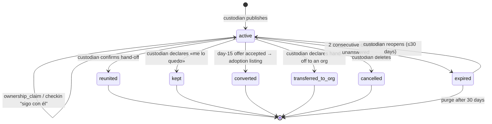

# Found Workflow — States & Domain

> The ENCONTRADO vertical. Source of truth for the found flow and for the boundary between lost,
> found, and sightings; where it disagrees with earlier docs, this one wins and the others get
> patched. Shares machinery with [04-lost-workflow.md](04-lost-workflow.md) —
> `case_checkin`, the claim pattern, location precision — and says so instead of restating it.
> Domain identifiers are English/snake_case; Spanish strings are UI copy.

## The flow, in one pass

```
«Encontré un animal» ──▶ «¿Lo tienes contigo?»
        │
        ├── sí ──▶ match against lost cases ──▶ hit:  recovery_claim on that lost case (no new case)
        │                                  └─▶ miss: found_case (active) ──▶ broadcast
        │                                                 │
        │                                                 ├── "Es mío" → ownership_claim (custodian confirms)
        │                                                 ├── check-ins → reunited | kept | transferred_to_org
        │                                                 └── custodian silent → expired
        │
        └── no ──▶ match against known pets ──▶ hit:  sighting on that pet's lost case
                                            └─▶ miss: orphan sighting (internal, 30 days, keeps matching)
```

## The organizing insight

Three roles, three doors, and the boundary is **perspective, not custody**:

| | **Lost** | **Found** | **Sighting** |
|---|---|---|---|
| Who | The owner: "I lost *mine*" | The custodian: "I have an animal that isn't mine" | Everyone else: "I saw one" |
| Creates | `lost_case` on a claimed pet | `found_case` on an `unclaimed` pet | A `sighting` — on a case if we can match it, orphan if we can't |
| Needs an account | Yes | Yes | No |
| Public card | Yes | Yes | **Never** |

A found case **is** custody. There is no witness variant of it: the neighbor who saw a stray roaming
is a sighting reporter, and the product never shows them a third top-level concept — they tap
«Encontré un animal», answer «¿Lo tienes contigo?», and the branch is ours to handle. This keeps
the home screen at two buttons and keeps non-owners out of the `owner` role by construction.

---

## Entities

### `pet`
Created `unclaimed` in the same transaction as the found case. The custodian fills the same
identification fields as a lost report (species, breed_guess, size, colors[], marks, photos[],
chip_number?) — which is exactly what matching needs.

### `responsibility_link`
The publisher gets `role = custodian`. Only two transitions in this flow touch the link — `kept`
and `transferred_to_org` — and they are the only responsibility transfers in either the lost or the
found flow.

### `found_case`
| Field | Notes |
|---|---|
| `pet_id`, `created_by` | Publisher is registered (account + phone verified) |
| `found_point`, `found_radius_m`, `found_at` | Where and when the animal was encountered. Area + time, same chips as lost. Public render floored at 200 m |
| `holding_where` | `home \| vet \| street_temporary \| no_longer_held` — one chip, **public**. Tells an owner what urgency to expect; `no_longer_held` covers "it ran off from my balcony" without forcing a resolution |
| `holding_point` | Exact point, **internal, never rendered to anyone**. Safety and ops: a dispute, helping an org locate a pickup. The custodian shares their address in chat if and when they choose |
| `held_since` | Anchors the **hold clock** (below). Defaults to `found_at`; independent of check-ins |
| `withheld_detail` | One identifying detail the finder keeps out of the public post — the ownership shibboleth (see the evidence ladder). **Never rendered anywhere**; replayed only to the custodian on the claim screen |
| `contact_prefs` | `expose_whatsapp`, `expose_email`, `in_app_only`. A custodian may reasonably stay `in_app_only` until a claimant earns trust — more important here than in lost |
| `successor_case_id?` | Set on `converted`: the adoption case this became |
| `status`, `resolution`, `resolution_attribution` | State machine below |
| `published_at`, `resolved_at` | No schedule fields — the follow-up schedule lives in `case_checkin` rows, as in lost |

Location precision follows the lost rules exactly: computation on the stored center, rendered circle
floored at 200 m. The floor matters *more* here — the custodian's home is where the animal is
**right now**.

At publish, the form prompts for the withheld detail: «Guarda un dato que solo el dueño sabría —
algo que no se vea en las fotos: una cicatriz, el color del collar, si está esterilizado.» Left
alone, finders put everything in the photos and description, leaking every detail an opportunist
needs. The prompt is what creates the shibboleth.

#### Publishing: match first, then create

Before a found case is written, the form runs matching against pets with an active lost case
(§ Matching). A hit is shown as «¿Es este?». Yes → a `recovery_claim` is opened on that lost case
and **no found case is created** — the animal already has an owner looking, and a second card for
it is exactly the duplicate we don't want. Miss → the found case is created: `pet` (`unclaimed`) +
`responsibility_link` (`custodian`) + `found_case`, one transaction.

### `ownership_claim` — «Es mío»
`case_id`, `claimant_person_id` (**never anonymous** — see below), `from_lost_case_id?`,
`evidence_kind[]`, `evidence_notes`, `evidence_photos[]`, `chip_number?`,
`status: open | confirmed | dismissed | withdrawn | stale`, `verifying_since?`, `stale_at`.

Mirror of `recovery_claim`, same answer loop, reversed trust:

- **Registered only.** A deliberate asymmetry from «lo tengo», which stays anonymous-friendly:
  there, the anonymous person is doing a favor and holds nothing. Here, they are asking to *take*
  an animal. Asymmetric stakes, asymmetric identity requirements — and the real owner has the
  strongest incentive of anyone to do one-tap OAuth.
- The row is created **before** any contact channel opens.
- It adds a «posible dueño» badge and accelerates check-ins. It never changes the case status.
- The custodian answers: confirm («sí, es el dueño»), dismiss, or «aún verificando». Silence →
  `stale` at `stale_at` (claim + 7d, +72h per «verificando»), badge drops, case stays `active`.
  `withdrawn` is the claimant backing out; `stale → confirmed` stays possible.

#### The evidence ladder

A fake «lo tengo» costs the owner a wasted trip; a fake «es mío» hands a live animal to a stranger
— the one genuinely high-stakes decision in this flow. The platform never adjudicates; what it does
is **collect evidence on the claim form and rank it by how hard it is to fake**, so the custodian
decides informed:

| # | Evidence | Strength |
|---|---|---|
| 1 | **A lost case for a matching animal, published *before* this found case** | Strongest, and system-verified: our own timestamps. A scammer who sees the found post today cannot publish a lost case last Tuesday. Computed from `from_lost_case_id`, never asked for |
| 2 | Names the `withheld_detail` unprompted | Only someone who knew the animal before the photos existed can |
| 3 | Chip number, vet records, photos of the pet **with** the claimant | Strong, human-checked |
| 4 | Cold claim — nothing attached | Allowed, but the claim card says so: «⚠️ sin evidencia» |

The «Es mío» form collects it in one screen, **everything optional** (proof is offered, never
required — a claimant can equally send things in chat): «Describe algo que no salga en las fotos»
(free text → `evidence_notes`, compared by the custodian against the withheld detail), optional
photos / chip number / vet card, and tier 1 attaching itself when the claimant arrived via matching
or has a matching lost case. The custodian's claim screen shows the tier label — «⭐ publicó un
aviso de perdido antes de que lo encontraras» down to «⚠️ sin evidencia» — and replays the withheld
detail: «Guardaste: *collar verde*. Pregúntale por eso antes de entregar.»

Tier 1 is why the merge path is always preferred over a cold claim — route claimants through
«¿es tu mascota?» first. Repeat cold-claimers across found cases surface in the moderation queue
([09](09-reporting.md)): that pattern is the theft signal.

Safety copy to the custodian, at the badge and on the claim check-in:

> «Antes de entregarlo, pide el dato que guardaste, una foto anterior o el carnet de vacunas.
> Entrégalo en un lugar público.»

Confirming a claim that carries `from_lost_case_id` is the trigger for the merge (§ Merge).

### `sighting` — the lost entity, extended
Defined in 04. This flow adds:

- `case_id` is **nullable**. Null = **orphan**: a witness report we could not attach to any case.
- `case_id` may point at a `found_case` as well as a `lost_case` — a found case has a pre-custody
  trail too.
- Orphan-only fields: `species` (required), `size?`, `colors[]?`, `orphan_expires_at`
  (`created_at + 30d`). **Photo is required when orphan** — without a case for context, an
  orphan without a photo is unmatchable and worthless.
- Attaching an orphan sets `case_id`, keeps `seen_at`, clears `orphan_expires_at`. The row doesn't
  move; the trajectory shows it with its original time — the owner gets trail from *before* they
  published.
- At `orphan_expires_at`: matching stops, anonymous contact purged, row kept.

Orphans are **internal**: no card, no broadcast, not public. Their whole value is matching.

### `case_checkin`
Reused as-is from 04, including `deliveries[]`, `cancelled_at`, the derived `next_checkin_at` and
`unanswered_streak`, and "what counts as an interaction". This flow adds a third trigger,
`hold_clock`, and the found responses:
`still_holding | keep_searching | reunited | kept | converted_to_adoptable | transferred_to_org |
delete | claim_confirmed | claim_dismissed | still_verifying`.

---

## Two clocks

The most important mechanic in this flow, and lost has no equivalent:

| Clock | Anchored to | Asks | Consequence of silence |
|---|---|---|---|
| **Check-in clock** | `case_checkin` rows | "Is this post still true — do you still have it?" | Case `expired` |
| **Hold clock** | `held_since` | "This animal has been in limbo N days" | The day-15 adoption offer |

They are independent. A finder can be perfectly responsive (check-in clock healthy) while the
animal sits unclaimed for a month (hold clock screaming). Conflating them would let a diligent
finder's case drift forever. A lost case is a search; a found case is **custody in limbo with a
deadline**, and the product's job is to resolve the limbo — ideally by reunion, otherwise by
routing the animal somewhere better than a stranger's balcony.

A stale found case is worse than no found case: an owner recognizing their dog, calling, and
getting no answer is a specific cruelty. That's what the check-in clock exists to prevent.

---

## Case state machine



Same shape as lost with six exits instead of three — custody has more ways to end, and most of
them are honorable endings that aren't reunion.

### Rule: the hold clock routes the animal somewhere

At `held_since + 15 days` with no confirmed claim, the check-in changes shape — an **offer, not a
warning** (see the framing rule below):

> «Nadie ha reclamado a este peludo en 15 días. ¿Quieres publicarlo en adopción?»
> `[ Publicar en adopción ]  [ Lo entregué a una fundación ]  [ Me lo quedo ]  [ Sigo buscando al dueño ]`

The four buttons *are* the resolution enum. «Sigo buscando» re-arms the hold clock (+15 days);
«Publicar en adopción» → **`converted`**: a new `adoption_case` on the *same pet*, pre-filled from
it (photos, traits, «encontrado en el barrio Laureles en junio»), `successor_case_id` /
`predecessor_case_id` linking the two. The pet stays `unclaimed`, the custodian link continues —
listing is not a transfer ([06](06-adoption-workflow.md)).

This is the cross-vertical bridge the product map promised — "a found stray becomes adoptable" —
and since adoption launches individuals-first, it is the **primary source of v1 adoption
inventory**. The conversion rate at the day-15 offer is a launch metric. The 15 days has a legal
echo (Ley 1774's 15-day abandonment window, [O6](../open-items.md)) that makes it defensible
rather than arbitrary; it is never cited as law in UI copy.

### Rule: only the custodian closes a case as reunited
No claimant, no moderator, no timeout sets `reunited`. A confirmed `ownership_claim` is the
custodian's statement that the hand-off happened.

### Rule: `kept` is an assertion with a date, not a legal event
The button is available from day one — we cannot stop anyone from keeping an animal — and the copy
suggests waiting (period pending the lawyer question, [O6](../open-items.md)). On `kept`: custodian
link closes, a new link `role = owner` opens for the same person, pet `custody_state = claimed`.
The case **stays matchable against new lost cases for 30 days** after `kept`: if the real owner
surfaces, they open an ownership claim like anyone else and the merge path still works.

### Rule: `transferred_to_org` is a declared outcome in v1, not a process
The custodian taps «Lo entregué a una fundación», optionally names it (free text), and the case
resolves. Custodian link closes; pet returns to `unclaimed`; **no org link is created**. The
structured handoff — org accepts → `org` link → `custody_state = org_held` → flows into adoption —
is deferred ([D4](../open-items.md)). Recording the outcome honestly now costs nothing; building
the process before a foundation asks for it would.

### `resolution` values
`reunited_owner` · `kept_by_finder` · `converted_to_adoptable` · `transferred_to_org` ·
`found_deceased` · `not_a_stray` · `ran_off_again` · `duplicate` · `no_response`

`resolution_attribution: platform_claim | platform_match | platform_share | offline | unknown` —
asked at the reunion moment, same as lost.

---

## The follow-up loop

Same machinery as lost, **different framing**. Lost leans on loss aversion — «se archivará en 5
días» — because the owner has something to lose. A finder doesn't; threatening their post is an
empty threat and reads as ungrateful. The lever here is the **animal's future**:

> «¿Sigues con el perrito que encontraste?»
> `[ Sigo con él ]  [ Ya está con su dueño 🎉 ]  [ Me lo quedo ]  [ Lo entregué a una fundación ]  [ Eliminar ]`

A silent custodian is still the main way a found case goes stale, and the animal's situation is
then unknown — expiry matters **more** here; only the copy stops threatening.

Claim check-in, to the custodian, with the safety copy:

> «Alguien dice ser el dueño. Si no nos confirmas en 3 días, quitaremos el aviso de posible dueño.»
> «Antes de entregarlo, pide el dato que guardaste, una foto anterior o el carnet de vacunas.
> Entrégalo en un lugar público.»
> `[ Sí, es el dueño 🎉 ]  [ No es ]  [ Aún verificando ]`

### Schedule
**T+48h, then every 5 days** — faster than lost's 72h/weekly, because custody facts change fast (the
animal escapes, gets handed to a neighbor, the finder travels). Claim check-ins at +24h/+72h with
`stale_at = claim + 7d`, +72h per «aún verificando»; the hold clock fires its offer at
`held_since + 15d` independently of all of this; interaction resets the time-based clock to +5d
(check-in answers and explicit actions only; views don't count); escalation push → WhatsApp → email
on the same row; `unanswered_streak = 2` → `expired`; claim and hold-clock check-ins never count
toward the streak.

`expired` is soft: gone from feed and push, reachable by link, reopenable for 30 days. After 30
days the case is purged — and so is the **pet**, if it is still `unclaimed` with no other case and
no other link. A stray whose custodian went silent and whose owner never surfaced within the reopen
window cannot be found by anyone afterwards; keeping it only pollutes the matching pool. The share
link then shows «Este aviso ya no está disponible». Expiry itself changes nothing on the link or
custody ([01, rule 7](01-actors-and-entities.md)); purge is what removes the record.

---

## Matching — the contract this flow needs

The algorithm is its own doc ([O7](../open-items.md)); this section fixes what it must provide.

```
match(report) → candidates[] of { pet_id, confidence, why[] }
```

`report` = photo + species + point + time + optional traits. `why[]` is human-readable («misma
raza · 400 m · hace 2 días») so the confirmation screen explains itself. It matches **pets, not
cases**: identity first, then the pet's current situation says what the report means.

**Candidates are always confirmed by a human. The contract never auto-attaches.** That is why the
algorithm needs good *recall*, not precision — a missed candidate is quietly kept as an orphan; a
wrong candidate is one tap to dismiss. The failure mode that would hurt is the one we don't build:
auto-creating or auto-merging anything.

### Where it runs

| Trigger | Candidates from | Who confirms | On yes |
|---|---|---|---|
| Witness report («no lo tengo») | Pets with an active lost case nearby | The witness: «¿Es alguno de estos?» | Sighting attached to that pet's lost case |
| Found publish («sí lo tengo») | Pets with an active lost case | The custodian | `recovery_claim` on that lost case, **no found case created** |
| Lost publish | Active found cases + orphans ≤ 30d | The owner: «¿Es tu mascota?» · «Vieron uno parecido ayer a 600 m» | Found → `ownership_claim` with `from_lost_case_id`; orphan → attached with original `seen_at` |
| New orphan arrives | Lost cases published since | The owner, via notification | Attach |

### Outcomes by the matched pet's situation

| Matched pet… | The report means | Action |
|---|---|---|
| has an active **lost** case | A sighting, or a recovery claim if the reporter has it | Attach / open claim — same as reporting from inside the case |
| has an active **found** case | Contradiction: someone claims custody, yet it's seen elsewhere | **Open** ([O5](../open-items.md)). Until decided: silent, kept as orphan |
| has **no active case** | Wrong match, or the owner hasn't noticed yet | **Open** ([O5](../open-items.md)). A proactive «¿Luna está contigo?» is powerful and a false alarm is how trust dies. Until decided: silent, kept as orphan |
| no match | An animal we don't know | Orphan. Re-run against lost cases published later |

Both gated nudges unlock on the same measurement: false-match rate below a threshold over N
confirmations, computed from `match.confirmed` / `match.rejected`.

---

## Merge — when lost and found are the same animal

Triggered by a confirmed `ownership_claim` that carries `from_lost_case_id`, or by a confirmed
`recovery_claim` whose claimant has a found case for the same animal (rare: they published before
matching caught it).

1. The `unclaimed` pet folds into the claimed pet: photos, sightings, and the found case re-point.
2. The custodian link closes (`active_to = now`); the owner link continues untouched.
3. **Both** cases resolve: lost → `reunited_home`, found → `reunited_owner`, same
   `resolution_attribution`.
4. `pet.merged` fires; the absorbed pet id stays resolvable as an alias.

**Reversible**: a merge writes a `pet_merge` record (`survivor_id`, `absorbed_id`, `merged_at`,
`merged_by`) and nothing is deleted. Undo re-points everything back and reopens both cases. A wrong
merge otherwise destroys two records at once — this is the trickiest operation in the system and
the price of the pet-centric model.

What remains of the "duplicate" problem after matching-first publish: two custodians for one
animal is impossible (one of them doesn't have it), so a second found case for the same animal is
either a wrong match or a hand-off nobody told us about. Detect on publish, offer, never block.

---

## Identity ladder for this vertical

| Action | Anonymous | Registered |
|---|---|---|
| View, share the card | ✓ | ✓ |
| Witness report («no lo tengo») | ✓ — pin + photo required (an orphan without a photo is unmatchable); time defaults to now; contact optional, asked-for (decision #13) | ✓ — contact from profile |
| «Es mío» | ✗ — asking to *take* an animal, not to help | ✓ — always; `ownership_claim` + evidence form → WhatsApp or in-app thread |
| Contact the custodian | ✓ — WhatsApp deep link | ✓ — either |
| Report a publication (abuse) | ✓ — one tap, reason required ([09](09-reporting.md)) | ✓ |
| Earn points / attribution | ✗ | ✓ |
| Publish a found case (custody) | ✗ | ✓ — OAuth + phone verified |

Custody requires an account for the same reason lost publish does, with a stronger version of it:
the custodian must be reachable and accountable for a live animal.

---

## Hooks for the next verticals

- **Adoption**: a custodian who can't keep the stray lists it on the same pet row —
  [06](06-adoption-workflow.md) — and `adopted_in_app` transfers the link to the adopter.
  The `org` role and `custody_state = org_held` exist and are unused in v1; the structured
  `transferred_to_org` (D4) is the bridge from a finder to a foundation's listing.
- **Help** (fundraising): a custodian holding an injured stray is the most common reason a
  campaign exists for an `unclaimed` pet. The pet row is the attachment point; nothing else here
  needs to change.

---

## Events

Named only where something consumes them — **N** notification ([08](08-notifications.md)),
**M** metric not derivable from rows, **A** audit. Publishes, resolutions, check-ins, dismissals,
orphan creation: queries over rows.

| Event | Consumer |
|---|---|
| `found_case.broadcast_sent` | N — custodian confirmation; neighborhood push |
| `ownership_claim.opened` | N — custodian, priority |
| `ownership_claim.confirmed` | N — claimant |
| `contact.opened` `{whatsapp_click}` | M — only evidence a WhatsApp contact happened |
| `contact.opened` `{thread_created}` | N — custodian |
| `found_case.expired` | N — custodian, push + email |
| `sighting.attached` | N — the witness; the only feedback an orphan reporter ever gets |
| `match.candidates_shown` | N — the custodian when a lost case matches theirs; N (gated, O5) for the two nudges; M — denominator of the mismatch rate |
| `match.confirmed` · `match.rejected` | M — the mismatch rate that unlocks O5. Not derivable: a rejection leaves no row |
| `pet.merged` · `pet.unmerged` | A — with the `pet_merge` record |
| `responsibility.transferred` | A — on `kept`, `transferred_to_org`, merge |

Notifications for this flow: [`08-notifications.md`](08-notifications.md) → **Found**.

---

## Open items

Tracked in [`open-items.md`](../open-items.md):

- **Open** — O5 matching-driven nudges (owner «¿está contigo?», custodian «¿sigues con él?») ·
  O6 legal: finder keeping a found animal · O7 the matching algorithm
- **Deferred** — D4 structured `transferred_to_org` · D5 «vistos en la zona» orphan map layer
