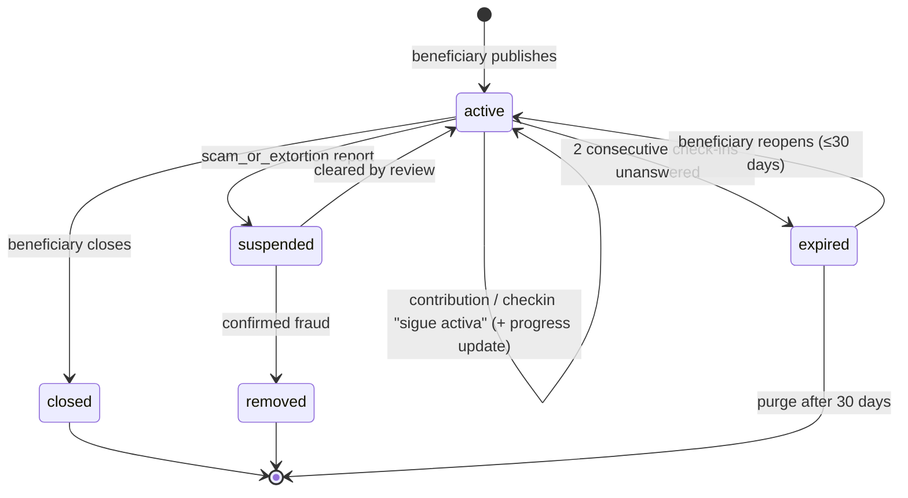

# Help Workflow — States & Domain

> The AYUDA vertical — money first, shaped so other kinds of help slot in later. Source of truth
> for the help flow; where it disagrees with earlier docs, this one wins and the others get patched.
> Reuses the machinery in [04](04-lost-workflow.md) — `case_checkin`, trust tiers from
> [06](06-adoption-workflow.md) — and says so instead of restating it.
> Domain identifiers are English/snake_case; Spanish strings are UI copy.

## The flow, in one pass

```
beneficiary ──«Pedir ayuda»──▶ link gate ──▶ Vaki (or similar) ──▶ paste link
  holds the pet                                                       │
                                                                      ▼
                                              help_request (active) ──▶ feed · shareable card
                                                        │
                                                        ├── «Quiero ayudar» → link-out (no row)
                                                        ├── «Ya ayudé»      → help_contribution (registered)
                                                        │
                                                        └── check-ins ──▶ beneficiary updates progress ──▶ closed
                                                                         beneficiary silent          ──▶ expired
```

## The organizing insight

**Link, don't host.** A help request is our card pointing at a campaign on a platform that already
does the hard part — cards and PSE, receipts, its own KYC and anti-fraud, a progress bar. We never
display a bank account or a Nequi handle, which removes the one scam surface a bulletin board of
payment rails has: a cloned card with a swapped number. «Money never touches the platform» (product
map, [03](03-legal-colombia.md)) becomes visibly true — not even the account number is on our page.

What we add over a WhatsApp forward of the Vaki link: the request lives on the **pet** (the history
reads «encontrado en la calle → cirugía financiada → adoptado» on one row), a trust tier an operator
can grant, a count of people who helped, and check-ins that keep a campaign from collecting money
after the need has ended.

`kind = money` is the only value in v1; the other kinds are deferred with their design
([D10](../open-items.md)).

**A request is always a bounded ask** — it must be able to end. «Cirugía de cadera» resolves;
«medicación por 3 meses» resolves; «apóyame cada mes para siempre» is a subscription in disguise
and out of scope — recurring money relationships are exactly what we don't intermediate. A
lifelong condition lives on `pet.health_flags[]` ([06](06-adoption-workflow.md)), durable
and case-less; it can still open a *bounded* request whenever there's a specific ask with an end.

---

## Entities

### `pet`
Already exists — the beneficiary holds it. A request changes nothing on the pet.

### `responsibility_link`
Must exist for the beneficiary (owner, custodian, or org). Untouched by this flow.

### `help_request`
| Field | Notes |
|---|---|
| `pet_id`, `created_by` | The beneficiary holds the pet |
| `kind` | `money` — only value in v1 |
| `external_url`, `external_host` | The campaign. `https` required; host shown on the card («campaña en vaki.co»). **One URL, one request** — the same link on a second request is a scam pattern; reject it |
| `story` | What happened, what's needed |
| `evidence[]` | Photos: vet diagnosis, quote, invoice. Optional to publish, **required to become `verified`** |
| `goal_amount?` (COP) | Optional — the platform already shows it; here it's for the card |
| `raised_amount?`, `raised_updated_at` | **Self-reported by the beneficiary**, updated at check-in, labeled «según el beneficiario» everywhere it appears |
| `trust_tier` | `unverified` · `verified` — below |
| `status`, `resolution`, `published_at`, `resolved_at` | Lifecycle below; no schedule fields — `case_checkin` rows |

No payout fields. No metadata fetched from the link — Vaki is a SPA with no OpenGraph we can rely
on, so our card uses the pet's photo and the beneficiary's story, and the link is the button.

### `help_contribution` — «Ya ayudé»
`request_id`, `person_id` (**always registered**), `amount?`, `created_at`.

One per person per request. Self-reported, never verified. What it feeds, and what it must not:

- The card shows **«14 personas ayudaron»** — a count, never a sum. The only money figure on the
  card is the beneficiary's `raised_amount`, labeled as theirs. The two numbers stay visibly
  separate so an unverified one never reads as verified.
- The beneficiary sees the list — who to thank.
- Points, when designed ([O8](../open-items.md)).

This is the only vertical where the helper row comes *after* the channel: there is no channel,
only a link-out, and the row is the donor's own claim.

### `case_checkin`
Reused from 04. Responses: `still_active | need_ended`. «Still active» carries the
`raised_amount` update.

---

## Publishing

The trip out to create a campaign happens **first**, before anything is written, so nobody fills a
story and then leaves.

**Step 1 — the link gate**
> «Para pedir ayuda necesitas una campaña donde la gente pueda donar. ¿Ya la tienes?»
> `[ Sí, pegar el enlace ]   [ Crear una en Vaki → ]`

«Crear en Vaki» opens the platform in the browser. When the beneficiary comes back, the app is
still on this step with a paste field — form state lives on the device; nothing is saved
server-side while they're away. No `draft` status, consistent with every other flow.

**Step 2 — paste and validate**: `https`, host extracted and shown, uniqueness across requests.
Any host is accepted — an allowlist would lock out whatever platform we haven't heard of; the
`verified` tier is where an operator checks it's a real campaign.

**Step 3 — story, evidence, goal** → publish. Three rows? No — one: the pet and link already
exist. `help_request` is written alone.

### Trust: tiered, not gated
- **`unverified`** — identity only. Publishes **immediately**, labeled prominently: «Sin verificar —
  la plataforma no ha revisado evidencia». Most requests start here.
- **`verified`** — an operator reviewed the evidence against the story and the link against the
  platform, or the org's personería jurídica is already on file. Manual queue ([02 · operator
  flows](02-flows.md)). Badge copy «Evidencia revisada» — *reviewed*, never *guaranteed*
  ([03](03-legal-colombia.md)). Criteria: [O9](../open-items.md).

Upgrading is the only review step; nothing waits on it.

---

## Case state machine



`suspended` is the one deliberate inversion of the reporting rule ([09](09-reporting.md), "a
report never hides an active case by itself"): a `scam_or_extortion` report here pauses **our
amplification** — feed, broadcast, share ranking — immediately and loudly, pending review against
the O11 SLA. The money side lives on Vaki behind its own KYC; what we lend a campaign is
credibility and reach, and that is what pauses. Loud means: the card shows «en revisión» (never
"scam"), the beneficiary is told why with a reply channel, and clearing restores everything. Same
mechanism as 09's auto-hide categories, same guards (device rate limits, reporter weight).

### `resolution` values
`goal_reached` · `need_ended` · `pet_recovered` · `pet_deceased` · `no_response` ·
`removed_by_moderation`

### Rule: silence is the fraud signal
A request still collecting money after the pet recovered or died is the abuse case for this
vertical, and the beneficiary going quiet is how it looks from our side. So check-ins matter more
here than anywhere, and every confirmation is also a progress update.

### Rule: removal touches only the request
`removed` leaves the pet, the links, and the contributions as they are. Contributors are not
notified — their money is already gone, and there is nothing for them to do.

---

## The follow-up loop

Same negative framing, same machinery, with the update prompt built in:

> «La campaña de Max sigue activa. Si no nos confirmas, la archivaremos en 5 días.»
> `[ Sigue activa — actualizar monto ]  [ Ya no necesita ayuda ]`

«Sigue activa» opens the `raised_amount` field. «Ya no necesita ayuda» asks why → `resolution`.

**Cadence:** T+7d, then every 14d. Escalation, interaction reset, soft expiry with a 30-day reopen:
as in 04. Expiry never changes the pet or the links ([01, rule 7](01-actors-and-entities.md)).

---

## Reach

Feed + shareable card (pet photo, AYUDA, host, link). **No geo push** — money doesn't travel on
proximity the way a lost dog does; the card on WhatsApp is the channel. A push to a pet's past
helpers («Luna, la que ayudaste a encontrar, necesita cirugía») is the obvious next thing and is
deferred ([D9](../open-items.md)).

---

## Moderation

Every request carries the report button ([09-reporting.md](09-reporting.md)). `scam_or_extortion`
suspends on the first report (state machine above); review clears it or confirms fraud →
`removed`. Every other reason queues normally. Same queue as every other vertical.

---

## Identity ladder for this vertical

| Action | Anonymous | Registered |
|---|---|---|
| View, share, follow the link | ✓ | ✓ |
| «Ya ayudé» | ✗ | ✓ |
| Publish a request | ✗ | ✓ — holds the pet |
| Report a publication (abuse) | ✓ — one tap, reason required ([09](09-reporting.md)) | ✓ |

---

## Events

Named only where something consumes them — **N** notification ([08](08-notifications.md)),
**M** metric not derivable from rows, **A** audit.

| Event | Consumer |
|---|---|
| `help_request.link_clicked` | M — the only evidence a donation *could* have happened; click-to-«ya ayudé» ratio is the engagement metric |
| `help_contribution.created` | N — beneficiary, coalesced |
| `help_request.expired` | N — beneficiary |
| `help_request.suspended` | N — beneficiary, with the reason and a reply channel |
| `help_request.removed` | N — beneficiary |

Notifications: [`08-notifications.md`](08-notifications.md) → **Help**.

---

## Partnership, later

Two things that need the platform's cooperation, neither blocking v1 ([D11](../open-items.md)):
a prefilled create-campaign deep link so Step 1 lands on a half-filled form, and a read API so
`raised_amount` updates itself instead of through check-ins.

## Open items

Tracked in [`open-items.md`](../open-items.md):

- **Open** — O9 verification criteria for `verified`
- **Deferred** — D8 closure message to contributors · D9 push to a pet's past helpers · D10 other
  `kind`s · D11 platform partnership (prefill + progress API)
