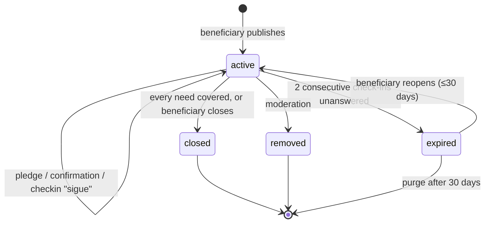

# Help Workflow — States & Domain

> The AYUDA vertical — **help in kind, never money** (decision #26, 2026-10-14). Source of truth for
> the help flow; where it disagrees with earlier docs, this one wins and the others get patched.
> Reuses the machinery in [04](04-lost-workflow.md) — `case_checkin`, area + radius — and the trust
> tiers from [06](06-adoption-workflow.md), and says so instead of restating it.
> Domain identifiers are English/snake_case; Spanish strings are UI copy.

## The flow, in one pass

```
beneficiary ──«Pedir ayuda»──▶ needs (hogar temporal · transporte · insumos) ──▶ help_request (active)
  holds the pet                                                                   │
                                                                                  ▼
                                                              feed (nearby) · shareable card
                                                                                  │
                                              «Yo ayudo» ──▶ help_pledge (registered, reachable)
                                                                                  │
                                              beneficiary marks it received ──▶ need covered
                                                                                  │
                                              check-ins ──▶ all covered / need ended ──▶ closed
                                                            beneficiary silent       ──▶ expired
```

## The organizing insight

**Ask for hands, not money.** A help request asks the people nearby for something they can give in
person: a home for a few weeks, a ride to the vet, a bag of food, a crate. The platform carries no
money and no trace of it — no amounts, no goals, no campaign links, no account numbers. That
removes the fraud a bulletin board of money asks invites, and keeps the help where this product is
strong: **proximity**. A lost dog is found by neighbours; a foster home, a ride and a bag of food
come from the same neighbours.

What we add over a WhatsApp message to the neighbourhood group: the request lives on the **pet**
(the history reads «encontrado en la calle → hogar temporal → adoptado» on one row), each need says
exactly what is asked, the people who offer are reachable and accountable, and only the beneficiary
says what actually arrived.

**A request is always a bounded ask** — it must be able to end. «Hogar temporal por 2 semanas
mientras se recupera» resolves; «transporte a la clínica el martes» resolves; «alguien que lo
cuide siempre» is an adoption, not help ([06](06-adoption-workflow.md)). A lifelong condition lives
on `pet.health_flags[]` ([06](06-adoption-workflow.md)), durable and case-less; it can still open a
*bounded* request whenever there's a specific ask with an end.

**A request for money is not a help request.** No field takes an amount, a link or an account; a
request whose story asks for money is out of scope and moderation closes it
([09](09-reporting.md), reason `other`).

---

## Entities

### `pet`
Already exists — the beneficiary holds it. A request changes nothing on the pet.

### `responsibility_link`
Must exist for the beneficiary (owner, custodian, or org). Untouched by this flow.

### `help_request`
| Field | Notes |
|---|---|
| `pet_id`, `created_by` | The beneficiary holds the pet |
| `story` | What happened, why the help is needed |
| `photos[]` | The pet; optional evidence (a vet note) — never of a person |
| `location_point`, `location_radius_m` | Where the help is needed — the same area picker and 200 m public floor as 04 · Location precision. Help in kind travels on proximity |
| `trust_tier` | `unverified` · `verified` — below |
| `status`, `resolution`, `published_at`, `resolved_at` | Lifecycle below; no schedule fields — `case_checkin` rows |

### `help_need` — one row per thing asked
| Field | Notes |
|---|---|
| `request_id` | One request carries 1–3 needs |
| `kind` | `foster` · `transport` · `supplies` — the v1 set. Other kinds deferred ([D10](../open-items.md)) |
| `detail` | Plain text, required: «2 semanas, mientras se recupera de la cirugía» · «De Envigado a la clínica en Laureles, martes 8 a. m.» · «Concentrado para gato adulto» |
| `unit`, `target?` | `foster` → homes, target 1; `transport` → trips; `supplies` → units of what `detail` says («3 bultos»). Optional target = «lo que puedan» |
| `needed_by?` | A date when it matters (the vet appointment) |
| `status` | `open` · `covered` · `closed` — `covered` when confirmed reaches the target, set by the beneficiary |

### `help_pledge` — «Yo ayudo»
`need_id`, `person_id` (**registered**), `quantity` (default 1), `note?`, `status: pledged |
confirmed | declined | withdrawn`, `created_at`, `confirmed_at?`.

- **Contact is required.** A foster we cannot reach is not a foster: pledging asks for the phone
  ([eng/auth.md](../eng/auth.md) · the phone step), and opens the channel to the beneficiary —
  `wa.me` per the beneficiary's contact prefs, like a claim in 04.
- **Only the beneficiary confirms.** `pledged → confirmed` when the ride happened, the food
  arrived, the animal is in the foster home. A pledger never marks their own help as done.
- **Progress shows both, never one self-reported number:** *confirmado* first, *prometido* second
  — «1 de 1 hogar confirmado» · «2 bultos confirmados · 1 prometido».
- The beneficiary sees who pledged — who to coordinate with, who to thank. Points, when designed
  ([O8](../open-items.md)), count **confirmed** pledges only.

### `case_checkin`
Reused from 04. Responses: `still_needed | need_ended`. «Sigue» shows the open needs so the
beneficiary can confirm what arrived in the same tap.

---

## Publishing

No trip out of the app, nothing to paste. One form, the steps every vertical shares:

1. **The pet** — one the beneficiary already holds (owner, custodian of a found case, org).
2. **The needs** — pick 1–3 kinds; each asks its `detail`, `target?` and `needed_by?`.
3. **Where** — area picker with radius chips (04 · Location precision).
4. **Story and photos** → publish. Phone step per the UI contract in [eng/auth.md](../eng/auth.md).

`help_request` and its `help_need` rows are written together. No `draft` status.

### Trust: tiered, not gated
- **`unverified`** — identity only. Publishes **immediately**, labeled: «Sin verificar — la
  plataforma no ha revisado quién pide». Most requests start here.
- **`verified`** — an operator reviewed who is asking: the org's personería jurídica on file, or,
  for an individual, a vet document that matches the pet and the story. Manual queue ([02 ·
  operator flows](02-flows.md)). Badge copy «Revisado» — *reviewed*, never *guaranteed*
  ([03](03-legal-colombia.md)). Criteria: [O9](../open-items.md).

Upgrading is the only review step; nothing waits on it.

### Safety copy, both sides
Help in kind means strangers meet and an animal changes hands. The pledge sheet and the
beneficiary's pledge list carry the same short rule: meet in a public place for handovers; a
foster home is a temporary arrangement between people, and the beneficiary stays responsible for
the animal (`responsibility_link` does not move — a foster is not an adoption).

---

## Case state machine



Reports follow [09](09-reporting.md)'s general rule — a report never hides an active request by
itself, except the auto-hide categories (`graphic_content`, `personal_data`). With no money on the
page there is no money-collecting fraud to race, so help has no special suspension.

### `resolution` values
`covered` · `need_ended` · `pet_deceased` · `no_response` · `removed_by_moderation`

### Rule: only the beneficiary closes a need
A need is `covered` when the beneficiary's confirmations reach its target, or when they say so.
Pledges alone never close anything — a promise is not a ride.

### Rule: removal touches only the request
`removed` leaves the pet, the links and the pledges' history as they are. Pledgers with an open
pledge are told the request is no longer active (08).

---

## The follow-up loop

Same negative framing, same machinery, with the confirmation built in:

> «La solicitud de Max sigue publicada. Si no nos confirmas, la archivaremos en 5 días.»
> `[ Sigue — marcar lo que llegó ]  [ Ya no necesita ayuda ]`

«Sigue» lists the open needs and their pledges to confirm. «Ya no necesita ayuda» asks why →
`resolution`.

**Cadence:** T+7d, then every 14d — or the day after a `needed_by` date, whichever comes first.
Escalation, interaction reset, soft expiry with a 30-day reopen: as in 04. Expiry never changes the
pet or the links ([01, rule 7](01-actors-and-entities.md)).

---

## Reach

Feed **by proximity** to `location_point`, national fallback like every feed, plus the shareable
card (pet photo, NECESITA AYUDA, the needs in one line). **No geo push in v1** — the push budget
belongs to lost pets; a push to a pet's past helpers («Luna, la que ayudaste a encontrar, necesita
un hogar temporal») is the obvious next thing and is deferred ([D9](../open-items.md)).

---

## Moderation

Every request carries the report button ([09-reporting.md](09-reporting.md)). A request that asks
for money is closed as out of scope. Every reason queues normally; same queue as every other
vertical.

---

## Identity ladder for this vertical

| Action | Anonymous | Registered |
|---|---|---|
| View, share | ✓ | ✓ |
| «Yo ayudo» | ✗ | ✓ — with a reachable phone |
| Publish a request | ✗ | ✓ — holds the pet |
| Report a publication (abuse) | ✓ — one tap, reason required ([09](09-reporting.md)) | ✓ |

---

## Events

Named only where something consumes them — **N** notification ([08](08-notifications.md)),
**M** metric not derivable from rows, **A** audit.

| Event | Consumer |
|---|---|
| `help_pledge.created` | N — beneficiary |
| `help_pledge.confirmed` | N — the pledger («Llegó, gracias») |
| `help_request.closed` | N — pledgers with an open pledge |
| `help_request.expired` | N — beneficiary |
| `help_request.removed` | N — beneficiary; pledgers with an open pledge |

Pledges per need and confirmation rates are queries over rows, not events.

Notifications: [`08-notifications.md`](08-notifications.md) → **Help**.

## Open items

Tracked in [`open-items.md`](../open-items.md):

- **Open** — O9 verification criteria for `verified`
- **Deferred** — D9 push to a pet's past helpers · D10 other `kind`s
